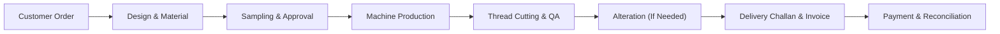
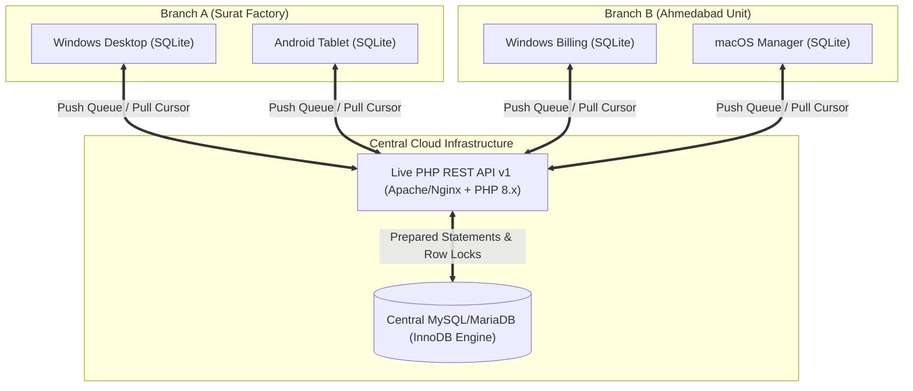
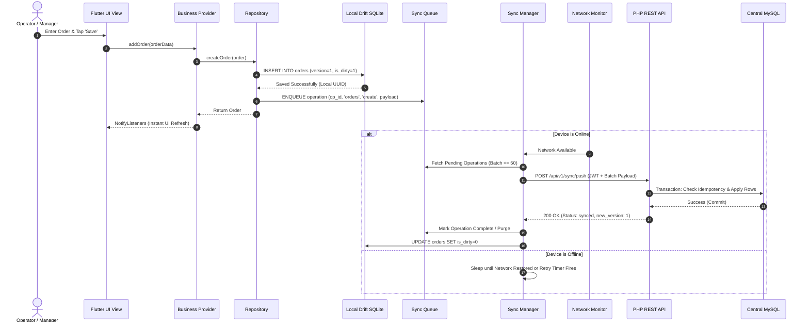
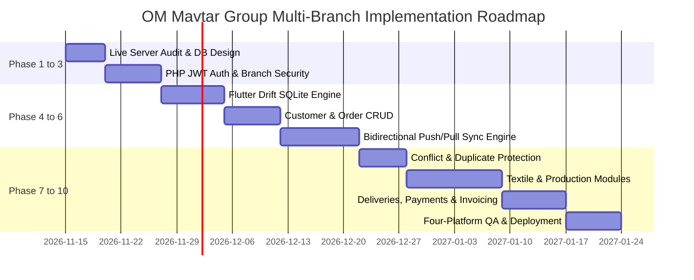

# OM Mavtar Group: Multi-Branch Offline-First Business Management System
## Complete Architectural Blueprint, Implementation Roadmap & Developer Maintenance Guide

---

## 📌 Document Overview

| Document Attribute | Details |
| :--- | :--- |
| **Project** | OM Mavtar Group Khata Book & Textile/Embroidery ERP |
| **System Model** | Centralized Multi-Branch, Offline-First, Bidirectional Synchronization |
| **Target Client Platforms** | Windows (Desktop), Android (Mobile/Tablet), iOS (Mobile/iPad), macOS (Desktop) |
| **Client Tech Stack** | Flutter + Provider + Drift (SQLite) + Dio + connectivity_plus |
| **Backend Tech Stack** | Existing Live PHP Server (REST API v1) + Central MySQL / MariaDB (InnoDB) |
| **Security Architecture** | JWT / Bearer Token + Strict Server-Side Branch Isolation Middleware |
| **Sync Philosophy** | Local-First (UI always reads/writes locally), Optimistic Locking, Idempotency Keys |
| **Author / Architect** | Antigravity AI & Engineering Team |
| **Target Audience** | Senior Flutter Developers, PHP Backend Engineers, System Administrators |

---

## 📑 Table of Contents

1. [Executive Summary & Architectural Philosophy](#1-executive-summary--architectural-philosophy)
2. [Current State vs Target State Gap Analysis](#2-current-state-vs-target-state-gap-analysis)
3. [End-to-End System Topology & Data Flow](#3-end-to-end-system-topology--data-flow)
4. [Central MySQL & Local Drift Database Schemas](#4-central-mysql--local-drift-database-schemas)
5. [Bidirectional Offline Sync Engine Specification](#5-bidirectional-offline-sync-engine-specification)
6. [Branch Data Security & Server Isolation Rules](#6-branch-data-security--server-isolation-rules)
7. [Flutter Client Implementation Blueprints](#7-flutter-client-implementation-blueprints)
8. [PHP Backend Architecture & Code Blueprints](#8-php-backend-architecture--code-blueprints)
9. [Pre-Development Live Server Audit Playbook](#9-pre-development-live-server-audit-playbook)
10. [Step-by-Step 10-Phase Implementation Roadmap](#10-step-by-step-10-phase-implementation-roadmap)
11. [Developer Maintenance, Migrations & Evolution Playbook](#11-developer-maintenance-migrations--evolution-playbook)
12. [Testing, QA & Failure Recovery Scenarios](#12-testing-qa--failure-recovery-scenarios)

---

## 1. Executive Summary & Architectural Philosophy

The objective is to transform the standalone **OM Mavtar Group Khata Book** into an enterprise-grade, **Multi-Branch Textile & Embroidery Business Management System** that seamlessly connects multiple factory branches, stores, offices, and mobile operators to a single central live PHP/MySQL server.

### The Core Embroidery & Textile Business Lifecycle
The application models the actual factory workflow:


### The 4 Non-Negotiable Architectural Principles

1. **Local-First Data Access**:
   The Flutter UI **never** waits for network round-trips to display screens or complete entries. The UI reads and writes **exclusively** to the local SQLite database via Drift. When the user taps "Save Order", the record is committed to SQLite instantly in milliseconds, updating the UI. The operation is then queued for server synchronization.
2. **Offline Autonomy**:
   Every branch and device continues normal operation without internet for hours, days, or weeks. All CRUD operations (except external bank gateway verifications) succeed locally.
3. **Idempotent & Resilient Push/Pull Sync**:
   Every mutation carries an immutable client-generated `operation_id` (UUID) and standard optimistic locking `version`. Duplicate network requests, app force-closes, or network drops never create duplicate records or corrupt data.
4. **Strict Server-Side Isolation**:
   No client-supplied `company_id` or `branch_id` is trusted blindly. The server validates branch access via signed JWT tokens and permission mappings on every API request.

---

## 2. Current State vs Target State Gap Analysis

### Current Architecture (`om_khatabook` v1.0)
* **Storage**: `SharedPreferences` + JSON string serialization (`StorageService`).
* **Scope**: Single-ledger commercial challans, parties, 5-pillar RBAC, local audit logs.
* **Connectivity**: 100% standalone on-device.

### Target Architecture (Multi-Branch ERP v2.0)
* **Storage**: Relational SQLite database powered by **Drift (Type-safe ORM)** on all 4 platforms (Windows, Android, iOS, macOS).
* **Scope**: Multi-branch organization, customer directory, order lifecycle, machine production, thread cutting, material inventory, deliveries, invoices, immutable payment receipts, and distributed audit logging.
* **Connectivity**: Offline-first hybrid with automatic bidirectional sync engine connected to existing live PHP/MySQL backend.

### Zero-Downtime Data Migration Path
To ensure existing users do not lose their current challans, parties, and RBAC accounts:
1. On initial launch of the upgraded app, a migration routine (`DataMigrationService`) checks if `SharedPreferences` contains existing v1 JSON data.
2. If found, it reads all parties and challan entries, generates stable UUIDs (preserving original `id` where possible), maps them to the default primary branch (`branch_id = 1`), and inserts them into SQLite tables within a single atomic Drift transaction.
3. Once the SQLite insertion is verified, a flag `migration_v1_to_v2_completed = true` is set in preferences. Existing JSON backups are retained as a safety fallback.

---

## 3. End-to-End System Topology & Data Flow



### Complete Client-Server Data Flow Sequence



---

## 4. Central MySQL & Local Drift Database Schemas

### Standard Universal Audit Columns
Every business record across both MySQL and Drift MUST include these 9 universal columns:

```sql
id              CHAR(36) PRIMARY KEY,     -- Client-generated RFC4122 v4 UUID
company_id      BIGINT UNSIGNED NOT NULL,  -- Organization root ID
branch_id       BIGINT UNSIGNED NOT NULL,  -- Owning branch
version         INT UNSIGNED NOT NULL DEFAULT 1, -- Optimistic locking counter
created_by      CHAR(36) NOT NULL,         -- User UUID who created
updated_by      CHAR(36) NOT NULL,         -- User UUID who last modified
created_at      DATETIME(3) NOT NULL,      -- Millisecond-accurate timestamp
updated_at      DATETIME(3) NOT NULL,      -- Millisecond-accurate timestamp
is_deleted      TINYINT(1) NOT NULL DEFAULT 0 -- Soft-delete flag (0=Active, 1=Deleted)
```

---

### Module A: Organization, Branches & Access Control

```sql
-- 1. Companies Master
CREATE TABLE companies (
    id BIGINT UNSIGNED AUTO_INCREMENT PRIMARY KEY,
    name VARCHAR(150) NOT NULL,
    trade_name VARCHAR(150) NULL,
    gstin VARCHAR(20) NULL,
    phone VARCHAR(20) NOT NULL,
    email VARCHAR(100) NULL,
    address TEXT NULL,
    logo_path VARCHAR(255) NULL,
    is_active TINYINT(1) DEFAULT 1,
    created_at DATETIME NOT NULL DEFAULT CURRENT_TIMESTAMP
) ENGINE=InnoDB DEFAULT CHARSET=utf8mb4 COLLATE=utf8mb4_unicode_ci;

-- 2. Branches Master
CREATE TABLE branches (
    id BIGINT UNSIGNED AUTO_INCREMENT PRIMARY KEY,
    company_id BIGINT UNSIGNED NOT NULL,
    branch_code VARCHAR(20) NOT NULL, -- e.g. BR-SURAT-01
    name VARCHAR(150) NOT NULL,       -- e.g. Surat Main Factory
    phone VARCHAR(20) NULL,
    address TEXT NULL,
    gstin VARCHAR(20) NULL,
    is_head_office TINYINT(1) DEFAULT 0,
    is_active TINYINT(1) DEFAULT 1,
    created_at DATETIME NOT NULL DEFAULT CURRENT_TIMESTAMP,
    FOREIGN KEY (company_id) REFERENCES companies(id) ON DELETE CASCADE,
    UNIQUE KEY uq_company_branch_code (company_id, branch_code)
) ENGINE=InnoDB DEFAULT CHARSET=utf8mb4 COLLATE=utf8mb4_unicode_ci;

-- 3. Users Master
CREATE TABLE users (
    id CHAR(36) PRIMARY KEY,
    company_id BIGINT UNSIGNED NOT NULL,
    username VARCHAR(50) NOT NULL,
    password_hash VARCHAR(255) NOT NULL,
    display_name VARCHAR(100) NOT NULL,
    phone VARCHAR(20) NULL,
    role_id VARCHAR(50) NOT NULL, -- 'developer', 'admin', 'manager', 'clerk', or custom
    is_blocked TINYINT(1) DEFAULT 0,
    is_deleted TINYINT(1) DEFAULT 0,
    created_at DATETIME NOT NULL,
    updated_at DATETIME NOT NULL,
    FOREIGN KEY (company_id) REFERENCES companies(id),
    UNIQUE KEY uq_username (company_id, username)
) ENGINE=InnoDB DEFAULT CHARSET=utf8mb4 COLLATE=utf8mb4_unicode_ci;

-- 4. User Branch Authorizations
CREATE TABLE branch_users (
    id BIGINT UNSIGNED AUTO_INCREMENT PRIMARY KEY,
    company_id BIGINT UNSIGNED NOT NULL,
    user_id CHAR(36) NOT NULL,
    branch_id BIGINT UNSIGNED NOT NULL,
    can_manage_branch TINYINT(1) DEFAULT 0,
    assigned_at DATETIME NOT NULL DEFAULT CURRENT_TIMESTAMP,
    FOREIGN KEY (user_id) REFERENCES users(id) ON DELETE CASCADE,
    FOREIGN KEY (branch_id) REFERENCES branches(id) ON DELETE CASCADE,
    UNIQUE KEY uq_user_branch (user_id, branch_id)
) ENGINE=InnoDB DEFAULT CHARSET=utf8mb4 COLLATE=utf8mb4_unicode_ci;

-- 5. Dynamic Role Permissions (Matches the 5-Pillar Architecture)
CREATE TABLE role_permissions (
    id BIGINT UNSIGNED AUTO_INCREMENT PRIMARY KEY,
    company_id BIGINT UNSIGNED NOT NULL,
    role_id VARCHAR(50) NOT NULL,
    -- Pillar 1: View
    can_view_orders TINYINT(1) DEFAULT 1,
    can_view_parties TINYINT(1) DEFAULT 1,
    can_view_reports TINYINT(1) DEFAULT 1,
    can_print_invoice TINYINT(1) DEFAULT 1,
    -- Pillar 2: Add
    can_create_order TINYINT(1) DEFAULT 1,
    can_manage_parties TINYINT(1) DEFAULT 1,
    can_add_users TINYINT(1) DEFAULT 0,
    -- Pillar 3: Edit
    can_edit_order TINYINT(1) DEFAULT 1,
    can_edit_users TINYINT(1) DEFAULT 0,
    can_manage_settings TINYINT(1) DEFAULT 0,
    -- Pillar 4: Delete
    can_delete_order TINYINT(1) DEFAULT 0,
    can_restore_order TINYINT(1) DEFAULT 0,
    can_purge_bin TINYINT(1) DEFAULT 0,
    can_delete_users TINYINT(1) DEFAULT 0,
    can_permanent_delete_users TINYINT(1) DEFAULT 0,
    -- Pillar 5: Log
    can_view_audit_logs TINYINT(1) DEFAULT 0,
    can_clear_audit_logs TINYINT(1) DEFAULT 0,
    updated_at DATETIME NOT NULL DEFAULT CURRENT_TIMESTAMP ON UPDATE CURRENT_TIMESTAMP,
    UNIQUE KEY uq_company_role (company_id, role_id)
) ENGINE=InnoDB DEFAULT CHARSET=utf8mb4 COLLATE=utf8mb4_unicode_ci;
```

---

### Module B: Customers & Orders

```sql
-- 6. Customers / Parties
CREATE TABLE customers (
    id CHAR(36) PRIMARY KEY,
    company_id BIGINT UNSIGNED NOT NULL,
    branch_id BIGINT UNSIGNED NOT NULL,
    name VARCHAR(150) NOT NULL,
    phone VARCHAR(20) NOT NULL,
    alternate_phone VARCHAR(20) NULL,
    email VARCHAR(100) NULL,
    gstin VARCHAR(20) NULL,
    billing_address TEXT NULL,
    shipping_address TEXT NULL,
    opening_balance DECIMAL(12,2) DEFAULT 0.00,
    current_balance DECIMAL(12,2) DEFAULT 0.00,
    credit_limit DECIMAL(12,2) DEFAULT 0.00,
    version INT UNSIGNED NOT NULL DEFAULT 1,
    created_by CHAR(36) NOT NULL,
    updated_by CHAR(36) NOT NULL,
    created_at DATETIME(3) NOT NULL,
    updated_at DATETIME(3) NOT NULL,
    is_deleted TINYINT(1) NOT NULL DEFAULT 0,
    INDEX idx_customer_branch (branch_id, name),
    INDEX idx_customer_phone (phone)
) ENGINE=InnoDB DEFAULT CHARSET=utf8mb4 COLLATE=utf8mb4_unicode_ci;

-- 7. Orders (Embroidery Master Job)
CREATE TABLE orders (
    id CHAR(36) PRIMARY KEY,
    company_id BIGINT UNSIGNED NOT NULL,
    branch_id BIGINT UNSIGNED NOT NULL,
    order_no VARCHAR(50) NOT NULL, -- e.g. ORD/26-27/001
    customer_id CHAR(36) NOT NULL,
    order_date DATE NOT NULL,
    target_delivery_date DATE NULL,
    total_stitches INT UNSIGNED DEFAULT 0,
    total_quantity DECIMAL(10,2) DEFAULT 0.00,
    rate_per_unit DECIMAL(10,2) DEFAULT 0.00,
    total_amount DECIMAL(12,2) DEFAULT 0.00,
    discount_amount DECIMAL(12,2) DEFAULT 0.00,
    taxable_amount DECIMAL(12,2) DEFAULT 0.00,
    gst_rate DECIMAL(5,2) DEFAULT 5.00,
    gst_amount DECIMAL(12,2) DEFAULT 0.00,
    final_amount DECIMAL(12,2) DEFAULT 0.00,
    paid_amount DECIMAL(12,2) DEFAULT 0.00,
    balance_amount DECIMAL(12,2) DEFAULT 0.00,
    status VARCHAR(30) NOT NULL DEFAULT 'draft',
    -- Status pipeline: draft -> sample -> sample_approved -> in_production -> cutting -> alteration -> ready -> delivered -> completed
    notes TEXT NULL,
    version INT UNSIGNED NOT NULL DEFAULT 1,
    created_by CHAR(36) NOT NULL,
    updated_by CHAR(36) NOT NULL,
    created_at DATETIME(3) NOT NULL,
    updated_at DATETIME(3) NOT NULL,
    is_deleted TINYINT(1) NOT NULL DEFAULT 0,
    UNIQUE KEY uq_branch_order_no (branch_id, order_no),
    INDEX idx_order_date (branch_id, order_date),
    INDEX idx_order_customer (customer_id),
    INDEX idx_order_status (branch_id, status)
) ENGINE=InnoDB DEFAULT CHARSET=utf8mb4 COLLATE=utf8mb4_unicode_ci;
```

---

### Module C: Production, Sampling, Thread Cutting & Alterations

```sql
-- 8. Embroidery Machines
CREATE TABLE machines (
    id CHAR(36) PRIMARY KEY,
    company_id BIGINT UNSIGNED NOT NULL,
    branch_id BIGINT UNSIGNED NOT NULL,
    machine_number VARCHAR(30) NOT NULL, -- e.g. EMB-01
    brand VARCHAR(50) NULL,             -- e.g. Tajima, Barudan
    heads INT UNSIGNED NOT NULL,        -- e.g. 20 heads
    max_rpm INT UNSIGNED DEFAULT 1000,
    is_active TINYINT(1) DEFAULT 1,
    version INT UNSIGNED NOT NULL DEFAULT 1,
    created_by CHAR(36) NOT NULL,
    updated_by CHAR(36) NOT NULL,
    created_at DATETIME(3) NOT NULL,
    updated_at DATETIME(3) NOT NULL,
    is_deleted TINYINT(1) NOT NULL DEFAULT 0,
    UNIQUE KEY uq_branch_machine (branch_id, machine_number)
) ENGINE=InnoDB DEFAULT CHARSET=utf8mb4 COLLATE=utf8mb4_unicode_ci;

-- 9. Daily Production Entries
CREATE TABLE production_entries (
    id CHAR(36) PRIMARY KEY,
    company_id BIGINT UNSIGNED NOT NULL,
    branch_id BIGINT UNSIGNED NOT NULL,
    order_id CHAR(36) NOT NULL,
    machine_id CHAR(36) NOT NULL,
    operator_id CHAR(36) NOT NULL,
    shift VARCHAR(20) NOT NULL, -- 'day', 'night'
    entry_date DATE NOT NULL,
    stitches_completed INT UNSIGNED NOT NULL,
    pieces_completed DECIMAL(10,2) NOT NULL,
    rejection_pieces DECIMAL(10,2) DEFAULT 0.00,
    rejection_reason VARCHAR(255) NULL,
    notes TEXT NULL,
    version INT UNSIGNED NOT NULL DEFAULT 1,
    created_by CHAR(36) NOT NULL,
    updated_by CHAR(36) NOT NULL,
    created_at DATETIME(3) NOT NULL,
    updated_at DATETIME(3) NOT NULL,
    is_deleted TINYINT(1) NOT NULL DEFAULT 0,
    INDEX idx_prod_order (order_id),
    INDEX idx_prod_machine_date (machine_id, entry_date)
) ENGINE=InnoDB DEFAULT CHARSET=utf8mb4 COLLATE=utf8mb4_unicode_ci;

-- 10. Thread Cutting & QA Processing
CREATE TABLE thread_cutting (
    id CHAR(36) PRIMARY KEY,
    company_id BIGINT UNSIGNED NOT NULL,
    branch_id BIGINT UNSIGNED NOT NULL,
    order_id CHAR(36) NOT NULL,
    cutter_name VARCHAR(100) NOT NULL,
    received_quantity DECIMAL(10,2) NOT NULL,
    completed_quantity DECIMAL(10,2) NOT NULL,
    rejected_quantity DECIMAL(10,2) DEFAULT 0.00,
    status VARCHAR(30) NOT NULL DEFAULT 'in_progress', -- 'in_progress', 'completed', 'sent_to_alteration'
    completed_at DATETIME(3) NULL,
    version INT UNSIGNED NOT NULL DEFAULT 1,
    created_by CHAR(36) NOT NULL,
    updated_by CHAR(36) NOT NULL,
    created_at DATETIME(3) NOT NULL,
    updated_at DATETIME(3) NOT NULL,
    is_deleted TINYINT(1) NOT NULL DEFAULT 0,
    INDEX idx_tc_order (order_id)
) ENGINE=InnoDB DEFAULT CHARSET=utf8mb4 COLLATE=utf8mb4_unicode_ci;

-- 11. Alteration Log & Reprocessing
CREATE TABLE alterations (
    id CHAR(36) PRIMARY KEY,
    company_id BIGINT UNSIGNED NOT NULL,
    branch_id BIGINT UNSIGNED NOT NULL,
    order_id CHAR(36) NOT NULL,
    defect_type VARCHAR(100) NOT NULL, -- 'thread_break', 'shade_mismatch', 'needle_cut'
    quantity DECIMAL(10,2) NOT NULL,
    assigned_to VARCHAR(100) NULL,
    rectified_quantity DECIMAL(10,2) DEFAULT 0.00,
    status VARCHAR(30) NOT NULL DEFAULT 'pending', -- 'pending', 'rectified', 'rejected'
    notes TEXT NULL,
    version INT UNSIGNED NOT NULL DEFAULT 1,
    created_by CHAR(36) NOT NULL,
    updated_by CHAR(36) NOT NULL,
    created_at DATETIME(3) NOT NULL,
    updated_at DATETIME(3) NOT NULL,
    is_deleted TINYINT(1) NOT NULL DEFAULT 0,
    INDEX idx_alt_order (order_id)
) ENGINE=InnoDB DEFAULT CHARSET=utf8mb4 COLLATE=utf8mb4_unicode_ci;
```

---

### Module D: Delivery, Invoicing & Immutable Payments

```sql
-- 12. Delivery Challans
CREATE TABLE delivery_challans (
    id CHAR(36) PRIMARY KEY,
    company_id BIGINT UNSIGNED NOT NULL,
    branch_id BIGINT UNSIGNED NOT NULL,
    challan_no VARCHAR(50) NOT NULL,
    order_id CHAR(36) NOT NULL,
    customer_id CHAR(36) NOT NULL,
    delivery_date DATE NOT NULL,
    delivered_quantity DECIMAL(10,2) NOT NULL,
    transport_name VARCHAR(100) NULL,
    vehicle_no VARCHAR(30) NULL,
    receiver_name VARCHAR(100) NULL,
    version INT UNSIGNED NOT NULL DEFAULT 1,
    created_by CHAR(36) NOT NULL,
    updated_by CHAR(36) NOT NULL,
    created_at DATETIME(3) NOT NULL,
    updated_at DATETIME(3) NOT NULL,
    is_deleted TINYINT(1) NOT NULL DEFAULT 0,
    UNIQUE KEY uq_branch_challan (branch_id, challan_no),
    INDEX idx_delivery_order (order_id)
) ENGINE=InnoDB DEFAULT CHARSET=utf8mb4 COLLATE=utf8mb4_unicode_ci;

-- 13. Immutable Payments Ledger (Double-Entry / Reversal Pattern)
CREATE TABLE payments (
    id CHAR(36) PRIMARY KEY,
    company_id BIGINT UNSIGNED NOT NULL,
    branch_id BIGINT UNSIGNED NOT NULL,
    receipt_no VARCHAR(50) NOT NULL,
    customer_id CHAR(36) NOT NULL,
    order_id CHAR(36) NULL,
    amount DECIMAL(12,2) NOT NULL,
    payment_mode ENUM('cash', 'cheque', 'neft_rtgs', 'upi') NOT NULL,
    -- Financial Security: Payments cannot be edited directly. Reversals create a negative entry.
    is_reversal TINYINT(1) NOT NULL DEFAULT 0,
    reversal_of_id CHAR(36) NULL,
    reversal_reason VARCHAR(255) NULL,
    -- Cheque details
    cheque_no VARCHAR(30) NULL,
    cheque_date DATE NULL,
    bank_name VARCHAR(100) NULL,
    cheque_status ENUM('cleared', 'pending', 'bounced') DEFAULT 'cleared',
    transaction_ref VARCHAR(100) NULL,
    version INT UNSIGNED NOT NULL DEFAULT 1,
    created_by CHAR(36) NOT NULL,
    updated_by CHAR(36) NOT NULL,
    created_at DATETIME(3) NOT NULL,
    updated_at DATETIME(3) NOT NULL,
    is_deleted TINYINT(1) NOT NULL DEFAULT 0,
    UNIQUE KEY uq_branch_receipt (branch_id, receipt_no),
    INDEX idx_pay_customer (customer_id),
    FOREIGN KEY (reversal_of_id) REFERENCES payments(id)
) ENGINE=InnoDB DEFAULT CHARSET=utf8mb4 COLLATE=utf8mb4_unicode_ci;
```

---

### Module E: Synchronization Engine & Audit Tables

```sql
-- 14. Sync Devices Registered
CREATE TABLE sync_devices (
    id CHAR(36) PRIMARY KEY, -- Client Device UUID
    company_id BIGINT UNSIGNED NOT NULL,
    branch_id BIGINT UNSIGNED NOT NULL,
    user_id CHAR(36) NOT NULL,
    device_name VARCHAR(100) NOT NULL,  -- e.g. "Office Windows PC 1"
    platform ENUM('windows', 'android', 'ios', 'macos') NOT NULL,
    app_version VARCHAR(20) NOT NULL,
    last_sync_at DATETIME NULL,
    last_known_ip VARCHAR(45) NULL,
    is_authorized TINYINT(1) DEFAULT 1,
    created_at DATETIME NOT NULL DEFAULT CURRENT_TIMESTAMP
) ENGINE=InnoDB DEFAULT CHARSET=utf8mb4 COLLATE=utf8mb4_unicode_ci;

-- 15. Server Global Change Log (Sequential Pull Engine)
CREATE TABLE sync_changes (
    sequence_id BIGINT UNSIGNED AUTO_INCREMENT PRIMARY KEY, -- The global incremental cursor!
    company_id BIGINT UNSIGNED NOT NULL,
    branch_id BIGINT UNSIGNED NOT NULL,
    entity_name VARCHAR(50) NOT NULL, -- e.g. 'orders', 'customers', 'payments'
    record_id CHAR(36) NOT NULL,
    action ENUM('insert', 'update', 'delete') NOT NULL,
    version INT UNSIGNED NOT NULL,
    payload JSON NOT NULL, -- Snapshot of record at that version
    created_by CHAR(36) NOT NULL,
    created_at DATETIME(3) NOT NULL DEFAULT CURRENT_TIMESTAMP(3),
    INDEX idx_branch_seq (branch_id, sequence_id),
    INDEX idx_company_seq (company_id, sequence_id)
) ENGINE=InnoDB DEFAULT CHARSET=utf8mb4 COLLATE=utf8mb4_unicode_ci;

-- 16. Device Cursor State
CREATE TABLE branch_sync_state (
    device_id CHAR(36) NOT NULL,
    branch_id BIGINT UNSIGNED NOT NULL,
    last_acknowledged_sequence BIGINT UNSIGNED NOT NULL DEFAULT 0,
    updated_at DATETIME NOT NULL DEFAULT CURRENT_TIMESTAMP ON UPDATE CURRENT_TIMESTAMP,
    PRIMARY KEY (device_id, branch_id)
) ENGINE=InnoDB DEFAULT CHARSET=utf8mb4 COLLATE=utf8mb4_unicode_ci;

-- 17. Audit Logs (Who changed what)
CREATE TABLE audit_logs (
    id CHAR(36) PRIMARY KEY,
    company_id BIGINT UNSIGNED NOT NULL,
    branch_id BIGINT UNSIGNED NOT NULL,
    user_id CHAR(36) NOT NULL,
    user_role VARCHAR(50) NOT NULL,
    action VARCHAR(50) NOT NULL,     -- 'login', 'create', 'update', 'soft_delete', 'restore', 'purge'
    entity_type VARCHAR(50) NOT NULL,-- 'order', 'challan', 'customer', 'auth', 'payment'
    entity_id CHAR(36) NOT NULL,
    description TEXT NOT NULL,
    timestamp DATETIME(3) NOT NULL,
    ip_address VARCHAR(45) NULL,
    INDEX idx_audit_branch_date (branch_id, timestamp)
) ENGINE=InnoDB DEFAULT CHARSET=utf8mb4 COLLATE=utf8mb4_unicode_ci;
```

---

## 5. Bidirectional Offline Sync Engine Specification

### Push Synchronization (`/sync/push`)
When the client goes online or a change is queued, the Flutter Sync Engine batches pending operations and sends them to the server:

#### Request Payload: `POST /api/v1/sync/push`
```json
{
  "device_id": "4a73f8e2-b91a-4c22-8df3-8d009230bb11",
  "branch_id": 1,
  "operations": [
    {
      "operation_id": "9f11cae0-201a-4993-bd21-0a1827419aa2",
      "entity": "orders",
      "action": "create",
      "record_id": "b17f30e2-a001-4c11-9a10-221144332211",
      "base_version": 0,
      "payload": {
        "order_no": "ORD/26-27/0045",
        "customer_id": "c99a1122-3344-5566-7788-99aabbccdde0",
        "order_date": "2026-11-14",
        "target_delivery_date": "2026-11-20",
        "total_stitches": 250000,
        "total_quantity": 500.0,
        "rate_per_unit": 45.0,
        "final_amount": 22500.0,
        "status": "draft"
      }
    }
  ]
}
```

#### Response Payload:
```json
{
  "success": true,
  "server_time": "2026-11-14T18:55:00.123Z",
  "results": [
    {
      "operation_id": "9f11cae0-201a-4993-bd21-0a1827419aa2",
      "record_id": "b17f30e2-a001-4c11-9a10-221144332211",
      "status": "synced",
      "version": 1,
      "conflict": null
    }
  ]
}
```

---

### Pull Synchronization (`/sync/pull`)
Clients pull incremental updates by presenting their last confirmed `cursor` (sequence ID):

#### Request: `GET /api/v1/sync/pull?branch_id=1&cursor=4520&limit=100`

#### Response:
```json
{
  "success": true,
  "next_cursor": 4522,
  "has_more": false,
  "changes": [
    {
      "sequence_id": 4521,
      "entity": "orders",
      "record_id": "b17f30e2-a001-4c11-9a10-221144332211",
      "action": "update",
      "version": 2,
      "data": {
        "status": "in_production",
        "updated_by": "user-manager-uuid",
        "updated_at": "2026-11-14T18:52:10.000Z"
      }
    }
  ]
}
```

#### Cursor Acknowledgement: `POST /api/v1/sync/acknowledge`
```json
{
  "device_id": "4a73f8e2-b91a-4c22-8df3-8d009230bb11",
  "branch_id": 1,
  "acknowledged_cursor": 4522
}
```

---

### Optimistic Locking & Conflict Resolution Rule Matrix

```
Client Operation with base_version: V_client
Server Current Record version: V_server
```

| Condition | Outcome | Action |
| :--- | :--- | :--- |
| `V_client == V_server` | **Normal Accept** | Server accepts, updates row, increments to `V_server + 1`, logs in `sync_changes`. |
| `V_client < V_server` (Non-overlapping fields) | **Auto-Merge (Safe)** | Server automatically merges non-overlapping fields (e.g. User A changed delivery notes, User B changed phone number). |
| `V_client < V_server` (Overlapping critical fields) | **HTTP 409 Conflict** | Server preserves current record, returns 409 + server copy. Local client stores both in `RecordConflicts` table for user resolution. |
| Duplicate `operation_id` received | **Idempotent No-Op** | Server recognizes repeated request, returns existing sync status without re-executing. |

---

## 6. Branch Data Security & Server Isolation Rules

### The 4 Pillars of Server Security

1. **Never Trust Client Branch IDs**:
   The Flutter app sends `branch_id` in requests, but the PHP backend's `BranchAccessMiddleware` cross-checks:
   ```php
   $userBranches = $this->authService->getUserAuthorizedBranchIds($tokenUserId);
   if (!in_array($requestedBranchId, $userBranches)) {
       http_response_code(403);
       echo json_encode(["error" => "Access Denied to Branch ID: $requestedBranchId"]);
       exit;
   }
   ```
2. **Global Admins & Developers**:
   Users with `role_id = 'developer'` or `'admin'` can be authorized across all branches (`can_manage_all_branches = true`).
3. **Database Tenant Isolation Query Shaping**:
   Every database query executed on the server automatically injects `AND company_id = ? AND branch_id = ?`.
4. **Idempotency Guarantee**:
   All operations are wrapped in an InnoDB row-level lock:
   ```sql
   SELECT id FROM sync_operations WHERE operation_id = ? FOR UPDATE;
   ```

---

## 7. Flutter Client Implementation Blueprints

### Recommended Directory Structure (`lib/`)

```
lib/
├── main.dart
├── app/
│   ├── app.dart
│   ├── routes.dart
│   └── app_config.dart
├── core/
│   ├── api/
│   │   ├── api_client.dart            # Dio client + Token Interceptor
│   │   ├── api_endpoints.dart         # REST URIs
│   │   └── api_interceptor.dart       # JWT refresh & 401 handler
│   ├── database/
│   │   ├── app_database.dart          # Drift SQLite Database entry point
│   │   ├── app_database.g.dart        # Generated Drift code
│   │   ├── tables/                    # Modular Drift table definitions
│   │   │   ├── orders_table.dart
│   │   │   ├── customers_table.dart
│   │   │   ├── production_table.dart
│   │   │   ├── payments_table.dart
│   │   │   └── sync_tables.dart
│   │   └── daos/                      # Data Access Objects
│   ├── sync/
│   │   ├── sync_manager.dart          # Master sync scheduler & orchestrator
│   │   ├── sync_queue.dart            # Local FIFO mutation queue
│   │   ├── sync_push.dart             # Push engine
│   │   ├── sync_pull.dart             # Pull engine
│   │   ├── sync_cursor.dart           # Local cursor persistence
│   │   ├── sync_retry.dart            # Exponential backoff handler
│   │   └── conflict_manager.dart      # 409 review and field merge
│   ├── network/
│   │   └── network_service.dart       # connectivity_plus listener
│   └── auth/
│       ├── auth_service.dart          # Login, JWT, Biometrics
│       └── secure_storage.dart        # Encrypted token storage
├── models/                            # Plain Dart domain entities
├── repositories/                      # Repositories bridging DB & SyncQueue
│   ├── order_repository.dart
│   ├── customer_repository.dart
│   └── production_repository.dart
├── providers/                         # State Management
│   ├── auth_provider.dart
│   ├── branch_provider.dart
│   ├── order_provider.dart
│   └── sync_provider.dart
├── features/                          # UI Screens organized by Domain
│   ├── dashboard/
│   ├── customers/
│   ├── orders/
│   ├── production/
│   ├── thread_cutting/
│   ├── delivery/
│   └── payments/
└── shared/
    ├── widgets/
    └── themes/
```

---

### Key Flutter Dependencies (`pubspec.yaml`)

```yaml
dependencies:
  flutter:
    sdk: flutter

  # State Management
  provider: ^6.1.5+1

  # Local Database Engine
  drift: ^2.24.0
  sqlite3_flutter_libs: ^0.5.28 # Native SQLite bindings for Windows, Android, iOS, macOS
  path_provider: ^2.1.6
  path: ^1.9.1

  # Networking & Sync
  dio: ^5.8.0+1
  connectivity_plus: ^6.1.3
  uuid: ^4.6.0
  intl: ^0.20.3

  # PDF & Hardware Printing
  pdf: ^3.12.0
  printing: ^5.14.3
  excel: ^4.0.6

dev_dependencies:
  flutter_test:
    sdk: flutter
  flutter_lints: ^6.0.0
  drift_dev: ^2.24.0
  build_runner: ^2.4.15
```

---

### Drift Database Definition Blueprint (`app_database.dart`)

```dart
import 'dart:io';
import 'package:drift/drift.dart';
import 'package:drift/native.dart';
import 'package:path_provider/path_provider.dart';
import 'package:path/path.dart' as p;

part 'app_database.g.dart';

// Local Drift Table: Orders
class LocalOrders extends Table {
  TextColumn get id => text()(); // UUID Primary Key
  IntColumn get companyId => integer()();
  IntColumn get branchId => integer()();
  TextColumn get orderNo => text().withLength(max: 50)();
  TextColumn get customerId => text()();
  DateTimeColumn get orderDate => dateTime()();
  DateTimeColumn get targetDeliveryDate => dateTime().nullable()();
  IntColumn get totalStitches => integer().withDefault(const Constant(0))();
  RealColumn get totalQuantity => real().withDefault(const Constant(0.0))();
  RealColumn get ratePerUnit => real().withDefault(const Constant(0.0))();
  RealColumn get finalAmount => real().withDefault(const Constant(0.0))();
  TextColumn get status => text().withDefault(const Constant('draft'))();
  TextColumn get notes => text().nullable()();
  
  // Sync metadata
  IntColumn get version => integer().withDefault(const Constant(1))();
  BoolColumn get isDirty => boolean().withDefault(const Constant(false))();
  BoolColumn get isDeleted => boolean().withDefault(const Constant(false))();
  TextColumn get createdBy => text()();
  TextColumn get updatedBy => text()();
  DateTimeColumn get createdAt => dateTime()();
  DateTimeColumn get updatedAt => dateTime()();

  @override
  Set<Column> get primaryKey => {id};
}

// Local Drift Table: Sync Outbox Queue
class SyncQueueTable extends Table {
  TextColumn get operationId => text()(); // UUID
  TextColumn get entityName => text()(); // 'orders', 'customers', etc.
  TextColumn get action => text()();     // 'create', 'update', 'delete'
  TextColumn get recordId => text()();
  IntColumn get baseVersion => integer()();
  TextColumn get payloadJson => text()();
  IntColumn get retryCount => integer().withDefault(const Constant(0))();
  DateTimeColumn get createdAt => dateTime()();

  @override
  Set<Column> get primaryKey => {operationId};
}

@DriftDatabase(tables: [LocalOrders, SyncQueueTable])
class AppDatabase extends _$AppDatabase {
  AppDatabase() : super(_openConnection());

  @override
  int get schemaVersion => 1;

  @override
  MigrationStrategy get migration => MigrationStrategy(
    onCreate: (Migrator m) async {
      await m.createAll();
    },
    onUpgrade: (Migrator m, int from, int to) async {
      // Future schema migrations are handled cleanly here!
    },
  );
}

LazyDatabase _openConnection() {
  return LazyDatabase(() async {
    final dbFolder = await getApplicationDocumentsDirectory();
    final file = File(p.join(dbFolder.path, 'om_khatabook_local.sqlite'));
    return NativeDatabase.createInBackground(file);
  });
}
```

---

### Sync Manager Implementation Blueprint (`sync_manager.dart`)

```dart
import 'dart:async';
import 'dart:convert';
import 'package:connectivity_plus/connectivity_plus.dart';
import 'package:dio/dio.dart';
import '../database/app_database.dart';

class SyncManager {
  final AppDatabase db;
  final Dio dio;
  bool _isSyncing = false;
  Timer? _pollingTimer;

  SyncManager({required this.db, required this.dio});

  void initialize() {
    // 1. Listen to Network Connectivity Changes
    Connectivity().onConnectivityChanged.listen((results) {
      if (!results.contains(ConnectivityResult.none)) {
        triggerSync();
      }
    });

    // 2. Periodic background sync trigger (every 60 seconds when app is active)
    _pollingTimer = Timer.periodic(const Duration(seconds: 60), (_) {
      triggerSync();
    });
  }

  Future<void> triggerSync() async {
    if (_isSyncing) return; // Sync Lock (Mutex) prevents parallel colliding syncs
    _isSyncing = true;

    try {
      await _pushPendingQueue();
      await _pullIncrementalChanges();
    } catch (e) {
      // Log failure, retry handled on next tick or reconnect
    } finally {
      _isSyncing = false;
    }
  }

  Future<void> _pushPendingQueue() async {
    final pending = await (db.select(db.syncQueueTable)
          ..orderBy([(t) => OrderingTerm.asc(t.createdAt)])
          ..limit(50))
        .get();

    if (pending.isEmpty) return;

    final operations = pending.map((op) => {
      'operation_id': op.operationId,
      'entity': op.entityName,
      'action': op.action,
      'record_id': op.recordId,
      'base_version': op.baseVersion,
      'payload': jsonDecode(op.payloadJson),
    }).toList();

    final response = await dio.post('/api/v1/sync/push', data: {
      'operations': operations,
    });

    if (response.statusCode == 200 && response.data['success'] == true) {
      final results = response.data['results'] as List;
      for (final res in results) {
        if (res['status'] == 'synced') {
          // Remove from local sync queue
          await (db.delete(db.syncQueueTable)
                ..where((t) => t.operationId.equals(res['operation_id'])))
              .go();
        }
      }
    }
  }

  Future<void> _pullIncrementalChanges() async {
    // Pull server changes using stored cursor, apply locally in Drift transaction
  }

  void dispose() {
    _pollingTimer?.cancel();
  }
}
```

---

## 8. PHP Backend Architecture & Code Blueprints

### Directory Structure (`api/`)

```
api/
└── v1/
    ├── index.php                      # Front Controller & Router
    ├── config/
    │   ├── database.php               # PDO MySQL Connection & Options
    │   └── app_config.php             # JWT Secret & Limits
    ├── middleware/
    │   ├── AuthMiddleware.php         # Token verification
    │   └── BranchAccessMiddleware.php # Branch isolation check
    ├── controllers/
    │   ├── AuthController.php         # Login, Refresh, Profile
    │   ├── SyncController.php         # /sync/push & /sync/pull
    │   ├── OrderController.php        # Orders
    │   └── PaymentController.php      # Reversal payments
    └── services/
        ├── SyncService.php            # Transactional sync engine
        └── AuditService.php           # Distributed audit logger
```

---

### PHP Database Connection Blueprint (`config/database.php`)

```php
<?php
class Database {
    private static ?PDO $instance = null;

    public static function getConnection(): PDO {
        if (self::$instance === null) {
            $host = '127.0.0.1';
            $db   = 'om_mavtar_erp';
            $user = 'db_user';
            $pass = 'secure_password';
            $charset = 'utf8mb4';

            $dsn = "mysql:host=$host;dbname=$db;charset=$charset";
            $options = [
                PDO::ATTR_ERRMODE            => PDO::ERRMODE_EXCEPTION,
                PDO::ATTR_DEFAULT_FETCH_MODE => PDO::FETCH_ASSOC,
                PDO::ATTR_EMULATE_PREPARES   => false, // Real native prepared statements!
                PDO::MYSQL_ATTR_INIT_COMMAND => "SET NAMES utf8mb4 COLLATE utf8mb4_unicode_ci"
            ];

            self::$instance = new PDO($dsn, $user, $pass, $options);
        }
        return self::$instance;
    }
}
```

---

### PHP Transactional Push Handler (`SyncController.php`)

```php
<?php
require_once __DIR__ . '/../config/database.php';

class SyncController {
    private PDO $pdo;

    public function __construct() {
        $this->pdo = Database::getConnection();
    }

    public function handlePush(int $companyId, int $branchId, string $userId, array $operations): array {
        $results = [];

        foreach ($operations as $op) {
            $opId = $op['operation_id'];
            $entity = $op['entity'];
            $action = $op['action'];
            $recordId = $op['record_id'];
            $baseVersion = (int)$op['base_version'];
            $payload = $op['payload'];

            $this->pdo->beginTransaction();
            try {
                // 1. Idempotency Check: Was this operation already executed?
                $checkStmt = $this->pdo->prepare(
                    "SELECT version FROM sync_changes WHERE record_id = ? AND entity_name = ? ORDER BY sequence_id DESC LIMIT 1"
                );
                $checkStmt->execute([$recordId, $entity]);
                $existing = $checkStmt->fetch();

                if ($action === 'create') {
                    if ($existing) {
                        // Already created! Return existing version
                        $this->pdo->rollBack();
                        $results[] = [
                            'operation_id' => $opId,
                            'record_id' => $recordId,
                            'status' => 'synced',
                            'version' => (int)$existing['version']
                        ];
                        continue;
                    }

                    // Insert new order
                    $insertStmt = $this->pdo->prepare("
                        INSERT INTO orders (id, company_id, branch_id, order_no, customer_id, order_date, 
                                            total_stitches, total_quantity, rate_per_unit, final_amount, status, 
                                            version, created_by, updated_by, created_at, updated_at)
                        VALUES (:id, :company_id, :branch_id, :order_no, :customer_id, :order_date,
                                :total_stitches, :total_quantity, :rate_per_unit, :final_amount, :status,
                                1, :created_by, :updated_by, NOW(3), NOW(3))
                    ");

                    $insertStmt->execute([
                        ':id' => $recordId,
                        ':company_id' => $companyId,
                        ':branch_id' => $branchId,
                        ':order_no' => $payload['order_no'],
                        ':customer_id' => $payload['customer_id'],
                        ':order_date' => $payload['order_date'],
                        ':total_stitches' => $payload['total_stitches'] ?? 0,
                        ':total_quantity' => $payload['total_quantity'] ?? 0.0,
                        ':rate_per_unit' => $payload['rate_per_unit'] ?? 0.0,
                        ':final_amount' => $payload['final_amount'] ?? 0.0,
                        ':status' => $payload['status'] ?? 'draft',
                        ':created_by' => $userId,
                        ':updated_by' => $userId
                    ]);

                    // Record in Global Change Log for Pull Sync
                    $logStmt = $this->pdo->prepare("
                        INSERT INTO sync_changes (company_id, branch_id, entity_name, record_id, action, version, payload, created_by)
                        VALUES (?, ?, ?, ?, 'insert', 1, ?, ?)
                    ");
                    $logStmt->execute([$companyId, $branchId, $entity, $recordId, json_encode($payload), $userId]);

                    $this->pdo->commit();
                    $results[] = [
                        'operation_id' => $opId,
                        'record_id' => $recordId,
                        'status' => 'synced',
                        'version' => 1
                    ];
                }
            } catch (Exception $e) {
                $this->pdo->rollBack();
                $results[] = [
                    'operation_id' => $opId,
                    'record_id' => $recordId,
                    'status' => 'error',
                    'message' => $e->getMessage()
                ];
            }
        }

        return ['success' => true, 'results' => $results];
    }
}
```

---

## 9. Pre-Development Live Server Audit Playbook

Before writing backend code, create a simple non-sensitive script (`server_audit.php`) on the existing server to verify prerequisites:

```php
<?php
// server_audit.php - Safe environment verification script
header('Content-Type: application/json');

$report = [
    'php_version' => PHP_VERSION,
    'php_sapi' => php_sapi_name(),
    'extensions' => [
        'pdo' => extension_loaded('pdo'),
        'pdo_mysql' => extension_loaded('pdo_mysql'),
        'openssl' => extension_loaded('openssl'),
        'json' => extension_loaded('json'),
        'mbstring' => extension_loaded('mbstring'),
    ],
    'limits' => [
        'memory_limit' => ini_get('memory_limit'),
        'max_execution_time' => ini_get('max_execution_time'),
        'upload_max_filesize' => ini_get('upload_max_filesize'),
        'post_max_size' => ini_get('post_max_size'),
    ],
    'https' => (!empty($_SERVER['HTTPS']) && $_SERVER['HTTPS'] !== 'off') || $_SERVER['SERVER_PORT'] == 443,
];

echo json_encode($report, JSON_PRETTY_PRINT);
```

### Server Audit Checklist Table

| Audit Area | Minimum Requirement | Recommended | Action If Missing |
| :--- | :--- | :--- | :--- |
| **PHP Version** | PHP 7.4+ | **PHP 8.1 / 8.2** | Upgrade PHP version via cPanel / hosting panel |
| **MySQL Storage Engine** | InnoDB (Row Locks) | InnoDB (Percona / MariaDB 10.6+) | Enforce `ENGINE=InnoDB` on all tables |
| **HTTPS / SSL** | Required | Free Let's Encrypt SSL | Enable SSL; Flutter mobile enforces HTTPS |
| **Execution Timeout** | 30 seconds | 60 seconds | Configure `max_execution_time = 60` for bulk batches |
| **POST Request Body Size** | 8 MB | 16 MB | Standard JSON sync payload capacity (`post_max_size = 16M`) |

> **Note on File Scope**: Design files (.DST, .EMB) and raw heavy image attachments are completely excluded from server sync. Synchronization is strictly focused on lightweight, fast, tabular transactional business records.

---

## 10. Step-by-Step 10-Phase Implementation Roadmap



### Detailed Phase Milestones

1. **Phase 1: Existing Live Server Audit & Database Schema Execution**
   * Run audit script; verify PHP/MySQL version.
   * Execute Module A, B, C, D, E, F SQL migration scripts on MySQL.
2. **Phase 2: PHP Authentication & Branch Isolation Middleware**
   * Implement `/auth/login`, `/auth/refresh`, and `BranchAccessMiddleware`.
3. **Phase 3: Flutter Local SQLite Database Setup (Drift)**
   * Add Drift dependencies; generate Drift tables and DAOs.
   * Build `DataMigrationService` to migrate v1 `SharedPreferences` data to SQLite.
4. **Phase 4: Customer & Order Local CRUD**
   * Implement Customer and Order repositories reading and writing to SQLite.
5. **Phase 5: Bidirectional Offline-to-Online Sync Engine**
   * Implement FIFO `SyncQueueTable` in SQLite.
   * Implement `SyncManager` with `connectivity_plus` listener and batch push/pull routines.
6. **Phase 6: Conflict Resolution & Optimistic Locking**
   * Test HTTP 409 handling, auto-merges, and manual conflict resolution UI.
7. **Phase 7: Embroidery Lifecycle Modules**
   * Build Machines, Daily Production entries, Thread Cutting, and Alteration screens.
8. **Phase 8: Deliveries, Invoicing & Immutable Payment Reversals**
   * Build single-page GST invoice printing and payment receipts.
9. **Phase 9: Financial Reports, Multi-Branch Balances & Analytics**
   * Build cross-branch financial summaries, party outstanding balance sheets, and tax ledger audits.
10. **Phase 10: 4-Platform Release & Deployment**
    * Windows `.exe`/`.msix`, Android `.apk`/`.aab`, macOS `.dmg`, and iOS `.ipa`.

---

## 11. Developer Maintenance, Migrations & Evolution Playbook

> **"Developer ko aage jaake koi zyada issue nahi aana chahiye"**

This section is the definitive maintenance guide for future developers modifying this codebase.

### 1. How to Add a New Table or Column in Flutter (Drift SQLite)

When you need to add a new column (e.g. `urgent_flag` to `orders`):

1. Open the table file (e.g. `lib/core/database/tables/orders_table.dart`).
2. Add the column with a default value:
   ```dart
   BoolColumn get isUrgent => boolean().withDefault(const Constant(false))();
   ```
3. Open `lib/core/database/app_database.dart`:
   * Increment `schemaVersion` by 1:
     ```dart
     @override
     int get schemaVersion => 2; // Was 1
     ```
   * Add the migration step in `MigrationStrategy`:
     ```dart
     @override
     MigrationStrategy get migration => MigrationStrategy(
       onUpgrade: (Migrator m, int from, int to) async {
         if (from < 2) {
           await m.addColumn(localOrders, localOrders.isUrgent);
         }
       },
     );
     ```
4. Run the code generator:
   ```bash
   dart run build_runner build --delete-conflicting-outputs
   ```
5. **Result**: On user devices, when the app updates, Drift automatically runs `ALTER TABLE orders ADD COLUMN is_urgent INTEGER DEFAULT 0` without wiping the local database.

---

### 2. How to Add a New Column on Central MySQL Server

Always follow non-blocking schema migration standards:

```sql
-- 1. Always provide DEFAULT values so existing rows are valid
ALTER TABLE orders 
ADD COLUMN is_urgent TINYINT(1) NOT NULL DEFAULT 0 
AFTER status;

-- 2. Add an index if this column will be filtered in queries
CREATE INDEX idx_orders_urgent ON orders(branch_id, is_urgent);
```

---

### 3. API Versioning Rules

* Never break `/api/v1/` endpoints. Older installed devices will continue talking to `/api/v1/`.
* When breaking contract changes are required, create `/api/v2/`.
* Server supports both v1 and v2 simultaneously by routing requests in `index.php`.

---

### 4. Sync Stuck / Deadlock Emergency Runbook

If a client device's sync queue gets stuck (e.g. an operation repeatedly fails):
1. In the Flutter app, open **Settings > Developer Tools > Sync Diagnostic**.
2. Tap **Inspect Sync Outbox**: View the failing operation payload.
3. Tap **Skip & Quarantine Operation**: The operation is moved to `quarantined_operations` in SQLite with error details, allowing the rest of the queue to proceed.
4. The quarantined operation can be exported as a JSON log and sent to the developer for debugging.

---

## 12. Testing, QA & Failure Recovery Scenarios

Every release must pass these 11 automated and manual sync tests:

| Test # | Test Scenario | Steps | Expected Result |
| :--- | :--- | :--- | :--- |
| **T-01** | Offline Order Creation | Disconnect Wi-Fi/LAN, create 3 orders in Branch A. | Orders save instantly in SQLite; UI updates; 3 operations queued. |
| **T-02** | Automatic Reconnection Upload | Reconnect Wi-Fi. | SyncManager triggers; all 3 orders uploaded; server returns versions; queue empties. |
| **T-03** | Network Drop During Push | Turn on Airplane mode midway during push. | App does not crash; batch transaction rolls back safely; retry on reconnect. |
| **T-04** | Duplicate Push (Idempotency) | Replay exact same push payload using Postman. | Server responds with `status: synced`; no duplicate orders inserted. |
| **T-05** | App Force-Close During Sync | Kill app process while sync is in progress. | Pending queue is persisted in SQLite; resumes automatically on relaunch. |
| **T-06** | Simultaneous Branch Updates | Branch A updates Order 1; Branch B updates Order 2. | Both succeed independently; no conflicts. |
| **T-07** | True Conflicting Edit (409) | User A (offline) and User B (online) edit Order 1 final amount. | Server returns HTTP 409 Conflict; both versions preserved in conflict review dialog. |
| **T-08** | Unauthorized Branch Access | Branch A user manually crafts request for Branch B data. | Server rejects with HTTP 403 Forbidden. |
| **T-09** | Reinstall / Device Recovery | Log in on a brand new tablet. | Pull engine downloads all branch data from sequence 0; local SQLite populated. |
| **T-10** | High Volume (10,000 Rows) | Seed 10,000 orders on server; initial sync. | Streamed in paginated batches of 100; UI stays 60 FPS responsive. |
| **T-11** | Payment Reversal History | Cashier reverses a Rs. 5,000 payment. | Original record untouched; negative reversal entry linked; audit trail preserved. |

---

## 🎯 Conclusion & Next Steps

This document serves as the permanent architectural contract for **OM Mavtar Group**. Following this blueprint guarantees:
* Zero data loss during offline periods.
* Smooth multi-branch expansion across Surat and other textile hubs.
* Clean, bug-free onboarding for any new Flutter or PHP developer joining the project.

