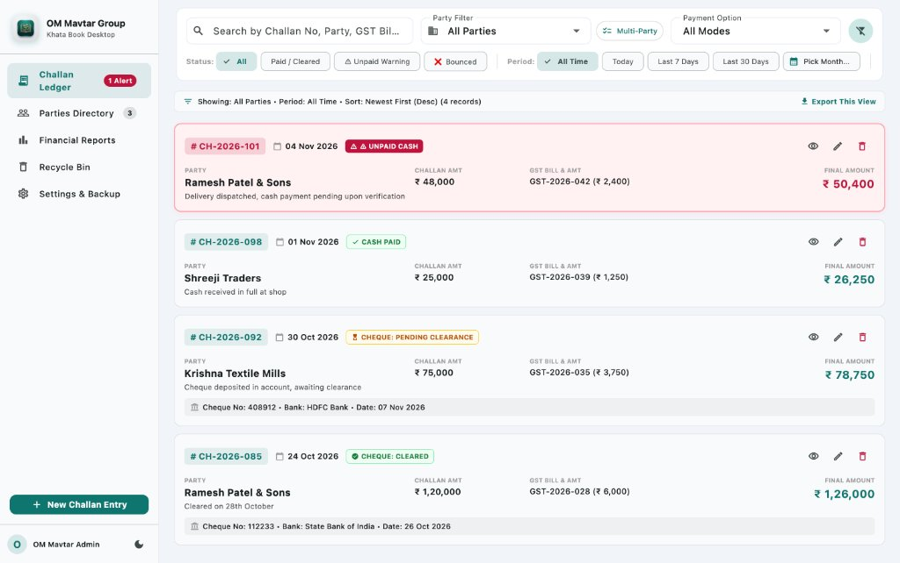
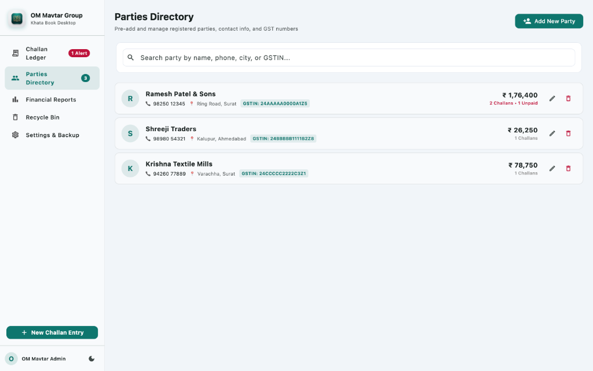

<p align="center">
  
</p>

# OM Mavtar Group Khata Book
### Enterprise Desktop Challan & Commercial Billing Management System

[](https://flutter.dev)
[](https://flutter.dev/desktop)
[-success.svg)](.github/workflows/build_windows_exe.yml)
[](test/)
[]()

A dedicated, production-grade desktop accounting and delivery challan ledger engineered specifically for **OM Mavtar Group**. Built with an **offline-first local architecture**, comprehensive manual financial controls, Excel-style spreadsheet views, two-stage Recycle Bin protection, automated GST invoice calculations, and enterprise PDF / Microsoft Excel (`.xlsx`) reporting.

---

## 📑 Table of Contents
1. [Application Screenshots](#-application-screenshots)
2. [Complete Features Guide (Abhi Tak Ke Sare Features)](#-complete-features-guide)
   - [1. Commercial Challan & Billing Ledger](#1-commercial-challan--billing-ledger)
   - [2. Multiple Ledger View Modes (Excel Table, Cards, Compact)](#2-multiple-ledger-view-modes)
   - [3. Pre-Registered Commercial Parties (Notebook Data)](#3-pre-registered-commercial-parties)
   - [4. Parties Directory & Dedicated Party Ledger View](#4-parties-directory--dedicated-party-ledger-view)
   - [5. Smart Party Autocomplete & Strict Validation](#5-smart-party-autocomplete--strict-validation)
   - [6. Flexible Optional Financial Amounts](#6-flexible-optional-financial-amounts)
   - [7. Automated GST Billing & 4 Fixed Prefix Chips](#7-automated-gst-billing--4-fixed-prefix-chips)
   - [8. Global Text Casing Controls](#8-global-text-casing-controls)
   - [9. Collapsible Navigation Sidebar & Direct Profile Modal](#9-collapsible-navigation-sidebar--direct-profile-modal)
   - [10. Centralized Reactive Branding & Live Logo Sync](#10-centralized-reactive-branding--live-logo-sync)
   - [11. Payment Options & Unpaid Cash Alert System](#11-payment-options--unpaid-cash-alert-system)
   - [12. Two-Stage Recycle Bin (Soft Delete & Permanent Purge)](#12-two-stage-recycle-bin)
   - [13. Professional PDF & Genuine Excel (.xlsx) Reports](#13-professional-pdf--genuine-excel-xlsx-reports)
   - [14. Cross-Platform Desktop Builds & CI/CD Packaging](#14-cross-platform-desktop-builds--cicd-packaging)
3. [Audit of Shortcomings & Areas for Improvement (Khamiyan)](#-audit-of-shortcomings--limitations-khamiyan)
   - [1. Database & Persistence Scalability](#1-database--persistence-scalability)
   - [2. Cloud Synchronization & Multi-Device Access](#2-cloud-synchronization--multi-device-access)
   - [3. Single-Page Commercial GST Tax Invoice Printing (A4/A5)](#3-single-page-commercial-gst-tax-invoice-printing-a4a5)
   - [4. Automated Bank Statement Reconciliation](#4-automated-bank-statement-reconciliation)
   - [5. Audit Trail & Modification History Log](#5-audit-trail--modification-history-log)
   - [6. User Authentication & Role-Based Access Control (RBAC)](#6-user-authentication--role-based-access-control-rbac)
   - [7. Automated Scheduled Local & Cloud Backups](#7-automated-scheduled-local--cloud-backups)
4. [Architecture & Technology Stack](#-architecture--technology-stack)
5. [Local Build & Development Guide](#-local-build--development-guide)

---

## 📸 Application Screenshots

### 1. Main Challan & Billing Ledger (Excel Table View)
High-density spreadsheet grid displaying multiple challan rows per screen, live KPI financial cards, and real-time status chips.
<p align="center">
  
</p>

---

### 2. Parties Directory & Dedicated Party Ledger
Individual commercial party records with live KPI aggregates and exclusive party transaction histories.
<p align="center">
  
</p>

---

### 3. Financial KPI Metrics & Filter Controls
Live summary cards calculating Total Challan Amount, Total Final Amount, Total GST Component, and Pending / Unpaid Dues with zero horizontal scrolling.
<p align="center">
  
</p>

---

## 🚀 Complete Features Guide

### 1. Commercial Challan & Billing Ledger
- **Full Manual CRUD**: Users have full manual control to add, edit, soft-delete, view, and filter every delivery challan and party record.
- **Comprehensive Fields**:
  - `Date`: Date picker defaulting to the current calendar date.
  - `Challan No.`: Unique commercial delivery voucher identifier (e.g., `CH-2026-101`).
  - `Party / Business Name`: Auto-suggested and validated against the registered parties directory.
  - `Challan Amount (₹)`: Base delivery amount (flexible/optional).
  - `Final Amount (₹)`: Final settlement figure (flexible/optional).
  - `Apply GST Bill`: Toggleable tax invoice calculation with customizable rate chips.
  - `GST Bill No.`: Tax invoice voucher with 4 pre-configured business prefix chips (`JK`, `OMC`, `MK`, `KK`).
  - `GST Amount (₹)`: Auto-calculated or manually specified GST component.
  - `Payment Option`: Cash (Fully Paid, Partially Paid, Unpaid) or Cheque (with bank, date, and clearance status).
  - `Remarks / Notes`: Optional text field for delivery notes or transport references.
- **Live Financial KPI Dashboard**:
  - **Total Challan Amount**: Sum of all base challan amounts matching active filters.
  - **Total Final Amount**: Sum of final settlement figures matching active filters.
  - **Total GST Amount**: Total tax liability calculated across all GST-applicable records.
  - **Pending / Unpaid Dues**: High-visibility counter highlighting unpaid cash and pending cheques requiring immediate follow-up.
- **Zero Horizontal Scroll Responsive Layout**:
  - Search input, party filters, payment mode selectors, status chips, period filters, and sorting controls use responsive `Wrap` widgets that automatically fit standard 1080p, 2K, and laptop displays without clipped buttons.

---

### 2. Multiple Ledger View Modes
Just like Windows File Explorer view settings, the ledger supports 3 distinct presentation layouts switchable from the top toolbar:
1. **Excel Table Grid View (Default)**:
   - High-density spreadsheet layout showing 10 to 15+ records simultaneously.
   - Clean column alignments: Date, Challan No., Party Name, Challan Amt, Final Amt, GST Bill & Amt, Payment Status, and Action Buttons.
   - Alternating row zebra shading and right-aligned currency formatting for effortless accounting audits.
2. **Cards View**:
   - Spaced, visual card presentation displaying complete payment badges, delivery notes, and transaction metadata.
   - Includes prominent light-red highlight panels for overdue or unpaid entries.
3. **Compact View**:
   - Streamlined single-row list format optimized for ultra-fast vertical scrolling across hundreds of transactions.
- **Persistent View Memory**: The chosen view mode is saved in local storage and remembered across app sessions.

---

### 3. Pre-Registered Commercial Parties
All dummy test data was completely removed, and the 16 real-world commercial trading parties from OM Mavtar Group's notebook were seeded into the permanent database:

| # | Registered Commercial Party Name | System Identifier | Default Status |
| :-: | :--- | :--- | :-: |
| 01 | **MANAV FAB** | `party_manav_fab` | Active |
| 02 | **SWASTIK CREATION** | `party_swastik_creation` | Active |
| 03 | **KAMDAR SILK MILLS** | `party_kamdar_silk_mills` | Active |
| 04 | **HEERA ENTERPRISE** | `party_heera_enterprise` | Active |
| 05 | **RADHE MOHAN SILK MILLS** | `party_radhe_mohan_silk_mills` | Active |
| 06 | **CHIRAG CREATION** | `party_chirag_creation` | Active |
| 07 | **OMKAR PARAG** | `party_omkar_parag` | Active |
| 08 | **GURU DHARMESH BHAI** | `party_guru_dharmesh_bhai` | Active |
| 09 | **MAYUR SILK MILLS** | `party_mayur_silk_mills` | Active |
| 10 | **PREE PRATIK** | `party_pree_pratik` | Active |
| 11 | **MOLI MOHAN** | `party_moli_mohan` | Active |
| 12 | **SHREE OM CREATION** | `party_shree_om_creation` | Active |
| 13 | **PRATHAM TRADING** | `party_pratham_trading` | Active |
| 14 | **RAKESH CORPORATION** | `party_rakesh_corporation` | Active |
| 15 | **VARNIKA** | `party_varnika` | Active |
| 16 | **MRT CREATION** | `party_mrt_creation` | Active |

---

### 4. Parties Directory & Dedicated Party Ledger View
- **Dedicated Party Ledger Screen**:
  - Clicking on any party in the Parties Directory opens an **isolated, exclusive ledger** for that specific party (`PartyLedgerDetailView`).
  - **Zero Cross-Contamination**: Displays strictly that party's transactions—no entries from other parties appear.
  - **Party Header Summary**: Displays registered business phone, address, GSTIN badge, and registration timestamp.
  - **Party-Specific KPI Cards**: Calculates Total Challan Amount, Total Final Amount, Total GST, and Pending Dues strictly for that individual account.
  - **Direct Actions**:
    - `+ Add Challan`: Automatically pre-selects the current party in the entry dialog.
    - `Export Party Ledger`: Instantly exports PDF statements or Excel files containing only that party's commercial history.

---

### 5. Smart Party Autocomplete & Strict Validation
- **Instant Keyboard Autocomplete**:
  - Typing in the Party field displays matching registered parties dynamically.
  - Pressing the **Enter** key (`onFieldSubmitted`) automatically selects the first/top suggestion from the list instead of keeping raw unfinished text.
- **Strict Party Integrity**:
  - The form actively verifies that the entered party exists in the registered database.
  - If a user types an unknown party name, submission is rejected with an inline error banner: *"Invalid party name. Please select from registered parties or add a new party."*
  - An inline `+ Add Party` quick shortcut button allows on-the-fly registration without abandoning the current challan form.

---

### 6. Flexible Optional Financial Amounts
- **No Mandatory Amount Blocks**:
  - Users can save challan records where `Challan Amount`, `Final Amount`, and `GST Amount` are optional.
  - Blank inputs safely default to `0.00` without triggering validation errors.
  - Accommodates preliminary delivery vouchers where goods have been dispatched but final billing settlement is calculated at month-end.

---

### 7. Automated GST Billing & 4 Fixed Prefix Chips
- **Interactive Tax Checkbox**: Checkbox toggle to apply GST billing on any delivery challan.
- **Intelligent Priority Auto-Calculation**:
  - **1st Priority**: Automatically checks `Final Amount`. If greater than zero, calculates:
    $$\text{GST Amount} = \text{Final Amount} \times \left(\frac{\text{GST Rate}}{100}\right)$$
  - **2nd Priority**: If `Final Amount` is zero or blank, falls back to `Challan Amount`:
    $$\text{GST Amount} = \text{Challan Amount} \times \left(\frac{\text{GST Rate}}{100}\right)$$
- **Quick Tax Rate Chips**: One-click percentage chips for standard Indian GST tax brackets:
  - `[ 5% ]`, `[ 12% ]`, `[ 18% ]`, `[ 28% ]`, with support for custom numeric rates.
- **Single-Select 4 Fixed Bill Prefixes**:
  - Pre-configured business prefix chips: `[ JK ]`, `[ OMC ]`, `[ MK ]`, `[ KK ]`.
  - **Single-Selection Rule**: Only one prefix can be active at a time; clicking another deselects the previous one.
  - **Instant Prefix Replacement**: Switching from `JK` to `OMC` dynamically swaps `JK-101` to `OMC-101` in the text field while preserving the entered serial digits.

---

### 8. Global Text Casing Controls
- **Default UPPERCASE Enforcement**:
  - In accordance with commercial transport and textile ledger practices, all text entry fields (Party Name, Challan Number, GST Bill Number, Bank Name, Remarks) automatically capitalize text as it is typed using Flutter `TextInputFormatter`.
- **Configurable Casing Modes in Settings**:
  - Users can configure their display and input preference under **Settings > Appearance**:
    1. **ALL UPPERCASE (Default)**: e.g., `SHREE OM CREATION`
    2. **all lowercase**: e.g., `shree om creation`
    3. **Capitalize Each Word (Title Case)**: e.g., `Shree Om Creation`

---

### 9. Collapsible Navigation Sidebar & Direct Profile Modal
- **Collapsible Desktop Sidebar**:
  - Smooth animated sidebar drawer toggling between **Expanded mode (260px)** with labels and **Collapsed mode (74px)** with compact icon rails.
  - Persistent toggle state remembered in `StorageService`.
- **Direct Company Profile Modal**:
  - Clicking the OM Mavtar Group company logo at the top-left of the application immediately opens the interactive **Company Profile & Branding Dialog** with full details and quick editing.

---

### 10. Centralized Reactive Branding & Live Logo Sync
- **Unified Logo Synchronization**:
  - Powered by the centralized `AppLogoWidget` and `StorageService` notification pipeline.
  - Updating the company logo or profile avatar in Settings or the Profile Dialog immediately updates the sidebar header, main window top bar, invoice dialogs, and reports in real time without restarting the application.
- **Embedded in Database Backups**:
  - Custom branding logos and avatars are serialized into the JSON backup file, ensuring complete brand preservation when restoring on another machine.

---

### 11. Payment Options & Unpaid Cash Alert System
- **Cash Payments**:
  - **Fully Paid**: Transaction marked cleared.
  - **Partially Paid**: Enables paid amount entry, automatically calculating remaining outstanding balance.
  - **Unpaid / Due**: Transaction flagged as pending payment.
- **High-Visibility Unpaid Cash Alert**:
  - Any challan marked as **Unpaid Cash** is immediately shaded in a prominent **light-red warning tone** with a bold alert badge: `[ ⚠️ UNPAID CASH ]`, ensuring overdue payments are never overlooked.
- **Cheque Payments**:
  - Cheque Issue Date, 6-digit Cheque Number, Issuing Bank Name (SBI, HDFC, ICICI, etc.), and Cheque Value.
  - Status management: `Pending Clearance`, `Cleared`, or `Bounced`.

---

### 12. Two-Stage Recycle Bin
- **Safe Soft-Deletion**:
  - Deleting any challan or party does not immediately destroy data; records are marked with `isDeleted: true` and moved to the Recycle Bin.
  - An immediate **Undo** snackbar allows single-click cancellation.
- **Recycle Bin Operations**:
  - **Restore**: Returns the record back into the active ledger or party directory.
  - **Delete Permanently**: Explicit confirmation prompt permanently purges the entry from storage.
  - **Empty Recycle Bin**: One-click complete purge of all trashed items.

---

### 13. Professional PDF & Genuine Excel (.xlsx) Reports
- **Formatted Printable PDF Statements**:
  - Landscape orientation with official OM Mavtar Group branding header.
  - Active filter summaries, financial KPI metric cards, clean alternating data rows, and automated page numbers.
  - One-click direct PDF export saved to the system's Documents folder.
- **Genuine Microsoft Excel (.xlsx) Export**:
  - Generated using real binary spreadsheet formatting (not plain `.csv`).
  - Auto-fitted column widths, styled header rows, and native numeric types allowing users to perform standard Excel calculations (`=SUM(...)`).
- **Flexible Report Filters**:
  - By Party: All Parties, Single Party, or Multi-Party interactive selection.
  - By Timeframe: Specific Calendar Month (e.g., November 2026), All Time Data, or Current Filtered View.
  - By Sorting: Date Ascending (Oldest First) or Date Descending (Newest First).

---

### 14. Cross-Platform Desktop Builds & CI/CD Packaging
- **Windows 10/11 Standalone Installer (.exe)**:
  - Custom Inno Setup script (`windows/installer/inno_setup.iss`) compiling a production `OmMavtarKhataBook_Setup.exe`.
  - Creates Start Menu and Desktop shortcuts, embeds the 32-bit DIB Windows icon, and registers clean uninstallation in **Windows Settings > Installed Apps**.
  - Also outputs a standalone portable ZIP package (`OmMavtarKhataBook_Windows_Portable_v2.0.0.zip`).
- **Automated GitHub Actions CI/CD Pipeline**:
  - Automated workflow (`.github/workflows/build_windows_exe.yml`) runs on push or manual trigger.
  - Sets up Flutter, runs tests, compiles Windows release binaries, executes Inno Setup, and uploads installer artifacts ready for download.
- **Native macOS Desktop Application**:
  - Compiled release bundle for macOS (`build/macos/Build/Products/Release/om_khatabook.app`).
  - App Sandbox security entitlements configured to prevent macOS `SIGTRAP` termination when launching from `/Applications` or Desktop.

---

## ⚠️ Audit of Shortcomings & Limitations (Khamiyan)

While OM Mavtar Group Khata Book is a robust, production-ready desktop tool, the following technical and functional limitations have been identified during audit. These represent clear opportunities for future engineering enhancements:

### 1. Database & Persistence Scalability
- **Current Architecture**: The application persists data by serializing the entire list of challans and parties into a JSON string stored inside `SharedPreferences` (Windows Registry on Windows, `NSUserDefaults` / plist on macOS).
- **Limitation (Khami)**:
  - While fast and zero-configuration for thousands of records, `SharedPreferences` requires serializing and deserializing the entire JSON payload into memory every time an edit occurs.
  - As commercial transactions reach 20,000+ entries over several financial years, memory usage and write latency will increase.
- **Recommended Upgrade**: Migrate to an embedded SQL database engine (such as SQLite via `sqflite_common_ffi`) or an embedded NoSQL engine (such as `Isar` or `ObjectBox`) supporting indexed disk queries, SQL pagination, and instant streaming.

---

### 2. Cloud Synchronization & Multi-Device Access
- **Current Architecture**: 100% offline-first local desktop application.
- **Limitation (Khami)**:
  - Transactions entered on Computer A are not automatically synchronized to Computer B in another branch or shop.
  - Data transfer currently requires manual JSON export from the Settings screen and manual import on the secondary machine.
  - Concurrent data entry across two machines without cloud sync creates merge conflicts.
- **Recommended Upgrade**: Implement optional background cloud sync using Supabase, Firebase Firestore, or a lightweight self-hosted REST backend with UUID-based conflict resolution.

---

### 3. Single-Page Commercial GST Tax Invoice Printing (A4/A5)
- **Current Architecture**: The PDF export engine creates comprehensive multi-row ledger statements, monthly reports, and filtered transaction audits.
- **Limitation (Khami)**:
  - The system does not currently feature a dedicated single-challan formal **GST Tax Invoice printing template** (A4 or A5 half-page receipt).
  - Missing formal tax invoice fields: HSN/SAC code classification, split CGST/SGST 50-50 breakdown columns, authorized signatory stamp box, terms & conditions footer, and Indian e-Way Bill / IRN QR code generation.
- **Recommended Upgrade**: Introduce a "Print Tax Invoice" button on individual challans that formats an industry-standard commercial GST tax invoice ready for physical dot-matrix or laser printing.

---

### 4. Automated Bank Statement Reconciliation
- **Current Architecture**: Cheque payment statuses (`Pending`, `Cleared`, `Bounced`) are tracked manually by user updates.
- **Limitation (Khami)**:
  - Operators must manually cross-reference paper bank statements and manually update each cheque's clearance status.
  - No automated import parser exists for bank statement formats (such as Excel `.xlsx`, `.csv`, or `.ofx` bank exports).
- **Recommended Upgrade**: Add a "Reconcile Bank Statement" wizard allowing users to upload their bank statement Excel file and automatically match cleared cheques by Cheque Number and Amount.

---

### 5. Audit Trail & Modification History Log
- **Current Architecture**: The two-stage Recycle Bin protects against accidental deletions.
- **Limitation (Khami)**:
  - If a user modifies an existing challan's amount, party name, or payment status, the previous values are overwritten without retaining an audit history log.
  - The business owner cannot see who modified an amount, what the previous value was, or the exact timestamp of modification.
- **Recommended Upgrade**: Implement an internal `AuditLog` table that records all changes: `timestamp`, `action` (`EDIT`), `field_name`, `old_value`, and `new_value`.

---

### 6. User Authentication & Role-Based Access Control (RBAC)
- **Current Architecture**: The application opens directly into the ledger without authentication prompts.
- **Limitation (Khami)**:
  - Anyone with physical access to the desktop computer can view total turnover, edit financial records, or delete parties.
  - There is no role distinction between an Admin (full access) and a Data Entry Operator (can add challans but cannot delete records or view overall financial profit KPIs).
- **Recommended Upgrade**: Add an optional Master PIN / Password lock on startup, with configurable Operator and Admin permission profiles.

---

### 7. Automated Scheduled Local & Cloud Backups
- **Current Architecture**: Database backups require the user to navigate to **Settings > Export Database Backup** and save the file manually.
- **Limitation (Khami)**:
  - If an operator forgets to perform periodic backups and the computer experiences hardware failure or operating system reinstallation, unbacked data could be lost.
- **Recommended Upgrade**: Add an automated background backup service that writes a daily timestamped snapshot to a configurable local folder or cloud-synced folder (such as Google Drive, OneDrive, or Dropbox).

---

## 🏗 Architecture & Technology Stack

```
om_khatabook/
├── .github/
│   └── workflows/
│       └── build_windows_exe.yml        # GitHub Actions CI/CD for Windows .exe
├── assets/
│   └── logo/
│       ├── app_logo.png                # Primary OM Mavtar Group branding logo
│       └── app_logo_white.png          # Transparent/light variant logo
├── docs/
│   └── screenshots/
│       ├── challan_ledger.jpg          # Main Challan Ledger screenshot
│       ├── parties_directory.png       # Parties Directory screenshot
│       └── overview_dashboard.jpg      # Financial KPI overview screenshot
├── lib/
│   ├── main.dart                        # App entry point with Provider scope & casing
│   ├── models/
│   │   ├── challan_entry.dart           # Challan model with soft-delete & warning flags
│   │   └── party.dart                   # Party model with notebook records & metadata
│   ├── providers/
│   │   └── challan_provider.dart        # Core business logic, filters, sorting, Recycle Bin
│   ├── services/
│   │   ├── export_service.dart          # PDF & Excel (.xlsx) report generation engine
│   │   └── storage_service.dart         # Local persistence, branding sync & JSON backup
│   ├── theme/
│   │   └── app_theme.dart               # Corporate OM Mavtar Group branding theme
│   ├── views/
│   │   ├── challan_list_view.dart       # Main Challan Ledger (Excel Grid, Cards, Compact)
│   │   ├── main_layout.dart             # Collapsible desktop sidebar & header navigation
│   │   ├── parties_view.dart            # Parties Directory with dedicated ledger navigation
│   │   ├── party_ledger_detail_view.dart # Dedicated isolated Party Ledger screen
│   │   ├── recycle_bin_view.dart        # Two-stage Recycle Bin with Restore & Purge
│   │   ├── settings_view.dart           # Text casing, branding, metrics & JSON backup
│   │   └── summary_reports_view.dart    # Financial overview & reporting launcher
│   └── widgets/
│       ├── add_edit_challan_dialog.dart # Form dialog with autocomplete & GST prefixes
│       ├── add_edit_party_dialog.dart   # Party creation and management dialog
│       ├── app_logo_widget.dart         # Centralized reactive branding logo widget
│       ├── export_report_dialog.dart    # PDF / Excel export wizard
│       └── view_challan_dialog.dart     # Detailed challan inspection viewer
├── test/
│   ├── party_autocomplete_gst_and_branding_test.dart # Autocomplete, GST & branding tests
│   ├── party_ledger_navigation_test.dart             # Dedicated party ledger tests
│   ├── recycle_bin_test.dart                         # Soft-delete & permanent purge tests
│   └── widget_test.dart                              # Desktop UI smoke tests
└── windows/
    ├── runner/
    │   └── resources/
    │       └── app_icon.ico             # 32-bit DIB Windows multi-resolution icon
    └── installer/
        └── inno_setup.iss               # Inno Setup Windows installer compiler script
```

---

## 💻 Local Build & Development Guide

### System Prerequisites
- **Flutter SDK**: `>=3.47.0`
- **Dart SDK**: Compatible with Flutter SDK
- **Desktop Tools**:
  - **macOS**: Xcode & CocoaPods
  - **Windows**: Visual Studio 2022 (with "Desktop development with C++" workload)

### 1. Run on macOS Desktop:
```bash
flutter pub get
flutter run -d macos
```

### 2. Run on Windows 10/11 Desktop:
```powershell
flutter pub get
flutter run -d windows
```

### 3. Run Automated Tests:
```bash
flutter test
```

### 4. Run Code Analysis:
```bash
flutter analyze
```

### 5. Build Standalone Windows Installer locally (on Windows):
```powershell
flutter build windows --release
iscc windows\installer\inno_setup.iss
```
Output setup executable will be located at:
`build\installer\OmMavtarKhataBook_Setup.exe`

---

<p align="center">
  <b>OM Mavtar Group Khata Book</b> • Dedicated Commercial Ledger System<br>
  Designed & Engineered for High-Reliability Desktop Accounting
</p>
