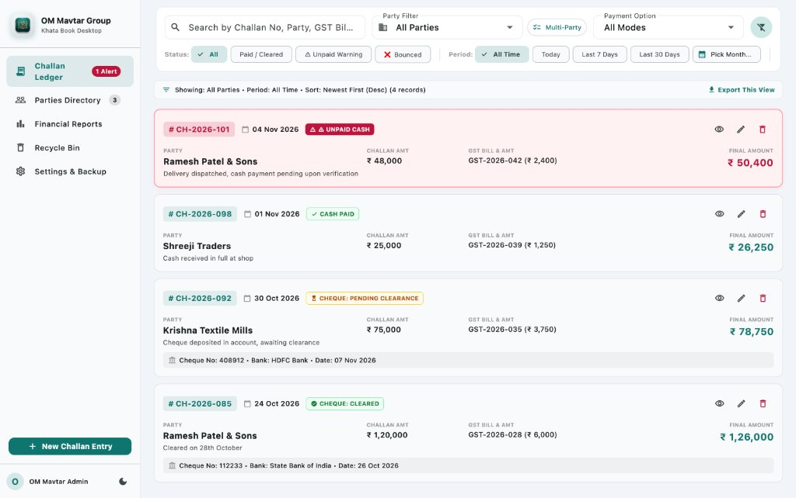
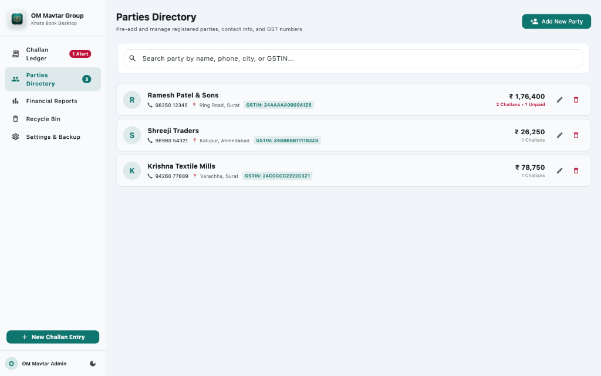
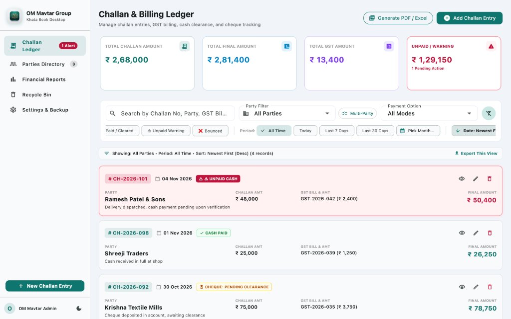

<p align="center">
  
</p>

# OM Mavtar Group Khata Book - Desktop Challan & Billing Management System

A dedicated, high-performance desktop ledger application built for **OM Mavtar Group**, optimized for **Windows 10/11** and **macOS**. Developed entirely in **100% English** with complete offline-first local storage, full manual CRUD controls, advanced PDF/Excel reports, two-stage Recycle Bin security, dedicated party-wise ledgers, and automated CI/CD for Windows setup `.exe` distribution.

---

## 📸 Application Screenshots

### 1. Challan & Billing Ledger (Main Screen)
The primary commercial ledger view showing live financial KPI cards, zero-horizontal-scroll filter toolbar, and delivery challans with prominent **light-red warning highlights** for unpaid cash entries.

<p align="center">
  
</p>

---

### 2. Parties Directory & Dedicated Party Ledger
Directory of registered commercial parties. Clicking on any party opens their **exclusive Party Ledger Screen** showing only their transactions, party-specific KPIs, and instant export options.

<p align="center">
  
</p>

---

### 3. Financial KPI Metrics & Smart Search
Real-time financial KPI cards calculating Total Challan Gross Amount, Total Final Billed Amount, Total GST Component, and Pending/Unpaid Dues.

<p align="center">
  
</p>

---

## 1. Key Features Overview

| Feature | Description |
| :--- | :--- |
| **Manual Data Control** | User manually creates, edits, soft-deletes, views, and filters all challan entries and parties. |
| **B2B Challan Fields** | Date, Challan No., Party, Challan Amount, Final Amount, GST Bill No., GST Amount, Payment Option (Cash / Cheque). |
| **Dedicated Party Ledger** | Clicking any party in the Parties Directory navigates to an exclusive screen displaying **only that party's records** with party-specific totals. |
| **Unpaid Cash Warning** | Unpaid / Pending cash entries are automatically highlighted in **light-red / warning tone** (`[ ⚠️ UNPAID CASH ]`). |
| **Cheque Settlement** | Cheque Date, Cheque No., Issuing Bank Name, Cheque Amount, Status (Pending, Cleared, Bounced). |
| **PDF & Excel Reports** | Filter by Single/Multiple Parties, Monthly/Period ranges, Ascending/Descending date sorting. |
| **Recycle Bin (Trash)** | Deleted challans and parties move to the Recycle Bin first. Restore anytime or permanently delete forever. |
| **Database Backup & Restore** | 100% offline JSON export and restore from the Settings screen. |
| **Windows Setup Installer (.exe)** | One-click `.exe` installer with desktop shortcuts and clean Windows Programs & Features uninstaller. |
| **macOS Native Desktop App** | Fully compiled release macOS app installed to Applications and Desktop with custom Retina app icons. |
| **Zero Horizontal Scroll** | Responsive `Wrap` layout ensures all filter chips and sorting controls fit on screen without horizontal scrolling. |

---

## 2. Core Field Specifications

Every delivery challan record in OM Mavtar Group Khata Book contains:

1. **Date** (`date`): Displayed prominently on the table and card; selectable via date picker (defaults to current date).
2. **Challan No.** (`challanNo`): Unique challan identifier (e.g. `CH-2026-101`).
3. **Party** (`partyName` / `partyId`): Selected through an instant searchable dropdown / autocomplete populated from pre-registered parties.
4. **Challan Amount** (`challanAmount`): Base gross amount of the delivery challan.
5. **Final Amount** (`finalAmount`): Final settlement amount payable/receivable.
6. **GST Bill No.** (`gstBillNo`): Tax invoice number corresponding to the challan.
7. **GST Amount** (`gstAmount`): GST component amount.
8. **Payment Option**:
   - **Cash**:
     - Status: `Paid` or `Unpaid / Pending`.
     - **Warning Highlight**: When marked unpaid, the entire row/card is shaded in light red with a distinct warning badge: `[ ⚠️ UNPAID CASH ]`.
   - **Cheque**:
     - *Cheque Date*: Issue date.
     - *Cheque No.*: 6-digit cheque identifier.
     - *Bank Name*: Issuing bank (e.g., SBI, HDFC, ICICI, Bank of Baroda).
     - *Cheque Amount*: Value written on the cheque.
     - *Cheque Status*: `Pending`, `Cleared`, or `Bounced`.
9. **Creation Timestamp** (`createdAt`): System timestamp automatically recorded in the background.

---

## 3. Dedicated Party Ledger View

When you navigate to the **Parties Directory** and click on any party card:
- You are taken to a dedicated **Party Ledger Screen** for that specific party.
- **Exclusive Records**: Displays **only that party's transactions**—no other party data is mixed in.
- **Party Header**: Displays party phone number, registered business address, GSTIN badge, and registration date.
- **Party KPI Summary Cards**:
  - Total Challan Gross Amount for this party.
  - Total Final Billed Amount for this party.
  - Total GST Component for this party.
  - Pending / Unpaid Dues for this party.
- **Dedicated Actions**:
  - `+ Add Challan`: Automatically pre-selects this party in the entry dialog.
  - `Export Party Ledger`: Generates PDF / Excel reports strictly for this party.
  - Full local search, payment mode filters, status filters, and date sorting.

---

## 4. Recycle Bin (Trash / Soft Delete)

To safeguard against accidental deletion:
- When a user deletes a challan or party, it is **moved to the Recycle Bin** (`isDeleted: true` with deletion timestamp).
- An immediate **Undo** snackbar allows instant reversal.
- In the **Recycle Bin** screen:
  - **Restore**: Returns the record back into the active ledger or party directory with a single click.
  - **Delete Permanently**: Permanently purges the record from the database. Once permanently purged, it cannot be recovered from any archive.
  - **Empty Recycle Bin**: Permanently deletes all soft-deleted records across both challans and parties.

---

## 5. Reports & Data Export (PDF & Excel)

Generate reports tailored to your exact business requirements:

### PDF Reports:
- **Print / Preview**: Landscape layout with OM Mavtar Group branding, active filter summary, summary KPI cards, styled data tables, and page counters.
- **Save PDF**: Directly writes formatted `.pdf` to your system's Documents folder.

### Excel (.xlsx) Reports:
- Generates genuine Microsoft Excel workbooks with formatted headers, dates, numbers, and calculated sum totals.

### Filter Scopes:
- **Party Selection**:
  - All Parties
  - Single Specific Party
  - Multiple Selected Parties (interactive multi-select)
- **Time Periods**:
  - Specific Month (Monthly Ledger, e.g. November 2026)
  - All Time Data
  - Current Filtered View
  - Custom Date Range
- **Date Sorting**:
  - **Ascending**: Oldest records first.
  - **Descending**: Newest records first.

---

## 6. Windows 10/11 Setup Installer (.exe) & GitHub Actions

### Automatic Cloud Builds via GitHub Actions
A complete GitHub Actions workflow (`.github/workflows/build_windows_exe.yml`) is set up to automatically build the Windows installer whenever you push to GitHub or trigger it manually:

1. **Push your code to GitHub**:
   ```bash
   git add .
   git commit -m "Add screenshots, party ledger screen, and installer updates"
   git push origin main
   ```
2. **Go to GitHub**:
   - Open your repository on GitHub in a web browser.
   - Click on the **Actions** tab at the top.
   - Select the workflow: **Build Windows Desktop Setup Installer (.exe)**.
   - Click **Run workflow** (or watch the push trigger automatically).
3. **Download the `.exe` Setup File**:
   - When the workflow completes (green checkmark), click on the run.
   - Scroll down to the **Artifacts** section at the bottom.
   - Click **OmMavtarKhataBook-Windows-Installer** to download the zip.
   - Extract the zip to get:
     - `OmMavtarKhataBook_Setup.exe` (Standalone Windows Installer)
     - `OmMavtarKhataBook_Windows_Portable_v2.0.0.zip` (Portable Version)
4. **Distribute & Run**:
   - Send `OmMavtarKhataBook_Setup.exe` directly to anyone on Windows 10/11.
   - Double-click to run the setup wizard.
   - The installer places the app in `Program Files`, adds Start Menu and Desktop shortcuts, and registers an official uninstaller in **Windows Settings > Installed Apps / Add or Remove Programs**.

### Local Windows Compilation (Optional, on a Windows PC):
```powershell
flutter build windows --release
iscc windows\installer\inno_setup.iss
```

---

## 7. How to Run Locally

### macOS Desktop:
```bash
flutter pub get
flutter run -d macos
```

### Windows 10 / 11 Desktop:
```powershell
flutter pub get
flutter run -d windows
```

### Run Tests:
```bash
flutter test
```

### Static Analysis:
```bash
flutter analyze
```

---

## 8. Project Architecture

```
om_khatabook/
├── .github/
│   └── workflows/
│       └── build_windows_exe.yml        # GitHub Actions CI/CD for Windows .exe
├── assets/
│   └── logo/
│       ├── app_logo.png                # Primary OM Mavtar Group branding logo
│       └── app_logo_white.png          # Transparent/light variant logo
├── docs/
│   └── screenshots/
│       ├── challan_ledger.jpg          # Main Challan Ledger screenshot
│       ├── parties_directory.png       # Parties Directory screenshot
│       └── overview_dashboard.jpg      # Financial KPI overview screenshot
├── lib/
│   ├── main.dart                        # App entry point with Provider scope
│   ├── models/
│   │   ├── challan_entry.dart           # Challan model with soft-delete & warning flags
│   │   └── party.dart                   # Party directory model with soft-delete
│   ├── providers/
│   │   └── challan_provider.dart        # Business logic, filters, sorting, Recycle Bin
│   ├── services/
│   │   ├── export_service.dart          # PDF & Excel (.xlsx) generator
│   │   └── storage_service.dart         # Local persistence & JSON backup/restore
│   ├── theme/
│   │   └── app_theme.dart               # Corporate branding theme (Light & Dark)
│   ├── views/
│   │   ├── challan_list_view.dart       # Main Challan Ledger with filters & warning highlight
│   │   ├── main_layout.dart             # Desktop sidebar layout with app logo & badges
│   │   ├── parties_view.dart            # Party directory management (click to view ledger)
│   │   ├── party_ledger_detail_view.dart # Dedicated Party Ledger Screen (exclusive records)
│   │   ├── recycle_bin_view.dart        # Recycle Bin with Restore & Permanent Delete
│   │   ├── settings_view.dart           # Backup, restore & database metrics
│   │   └── summary_reports_view.dart    # Financial KPI summary & export launcher
│   └── widgets/
│       ├── add_edit_challan_dialog.dart # Form dialog with party autocomplete
│       ├── add_edit_party_dialog.dart   # Party creation/editing dialog
│       ├── export_report_dialog.dart    # Report filter & export wizard
│       └── view_challan_dialog.dart     # Comprehensive challan details viewer
├── test/
│   ├── party_ledger_navigation_test.dart # Tests for party ledger navigation & filtering
│   ├── recycle_bin_test.dart            # Unit tests for soft-delete & permanent purge
│   └── widget_test.dart                 # Smoke tests for app UI
└── windows/
    ├── runner/
    │   └── resources/
    │       └── app_icon.ico             # Windows multi-resolution icon
    └── installer/
        └── inno_setup.iss               # Inno Setup Windows installer compiler script
```
