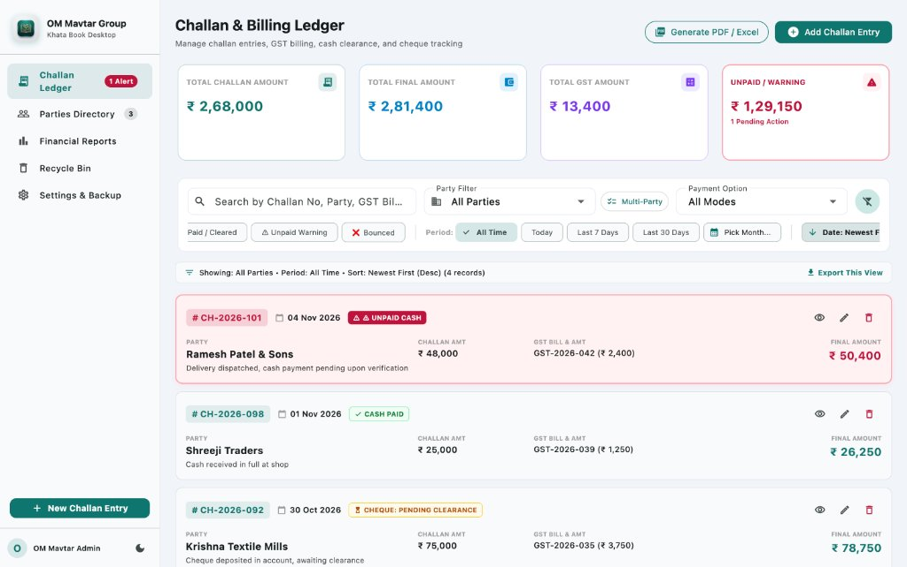

<p align="center">
  
</p>

# OM Mavtar Group Khata Book
### Enterprise Commercial Challan, Billing & RBAC Management System

[](https://flutter.dev)
[](https://flutter.dev)
[-success.svg)](.github/workflows/build_windows_exe.yml)
[](test/)
[]()
[]()

A dedicated, production-grade commercial accounting, delivery challan ledger, and tax invoicing system engineered specifically for **OM Mavtar Group**. Built with an **offline-first local architecture**, strict Role-Based Access Control (RBAC), tamper-evident audit logging, single-page A4/A5 GST tax invoice printing, Excel-style spreadsheet views, two-stage Recycle Bin protection, automated GST invoice calculations, and enterprise PDF / Microsoft Excel (`.xlsx`) reporting.

---

## 📑 Table of Contents
1. [Application Screenshots](#-application-screenshots)
2. [Complete Features Guide (Abhi Tak Ke Sare Features)](#-complete-features-guide)
   - [1. Commercial Challan & Billing Ledger](#1-commercial-challan--billing-ledger)
   - [2. Multiple Ledger View Modes (Excel Table, Cards, Compact)](#2-multiple-ledger-view-modes)
   - [3. Pre-Registered Commercial Parties (Notebook Data)](#3-pre-registered-commercial-parties)
   - [4. Parties Directory & Dedicated Party Ledger View](#4-parties-directory--dedicated-party-ledger-view)
   - [5. Smart Party Autocomplete & Strict Validation](#5-smart-party-autocomplete--strict-validation)
   - [6. Flexible Optional Financial Amounts](#6-flexible-optional-financial-amounts)
   - [7. Automated GST Billing & 4 Fixed Prefix Chips](#7-automated-gst-billing--4-fixed-prefix-chips)
   - [8. Global Text Casing Controls](#8-global-text-casing-controls)
   - [9. Collapsible Navigation Sidebar & Direct Profile Modal](#9-collapsible-navigation-sidebar--direct-profile-modal)
   - [10. Centralized Reactive Branding & Live Logo Sync](#10-centralized-reactive-branding--live-logo-sync)
   - [11. Payment Options & Unpaid Cash Alert System](#11-payment-options--unpaid-cash-alert-system)
   - [12. Two-Stage Recycle Bin (Soft Delete & Permanent Purge)](#12-two-stage-recycle-bin)
   - [13. Professional PDF & Genuine Excel (.xlsx) Reports](#13-professional-pdf--genuine-excel-xlsx-reports)
   - [14. Cross-Platform Desktop & Mobile Packaging](#14-cross-platform-desktop--mobile-packaging)
   - [15. Single-Page Commercial GST Tax Invoice Printing (A4/A5)](#15-single-page-commercial-gst-tax-invoice-printing-a4a5)
   - [16. Audit Trail & Modification History Log](#16-audit-trail--modification-history-log)
   - [17. User Authentication & Role-Based Access Control (RBAC)](#17-user-authentication--role-based-access-control-rbac)
3. [Audit of Shortcomings & Areas for Improvement (Khamiyan)](#-audit-of-shortcomings--limitations-khamiyan)
   - [1. Database & Persistence Scalability](#1-database--persistence-scalability)
   - [2. Cloud Synchronization & Multi-Device Real-Time Sync](#2-cloud-synchronization--multi-device-real-time-sync)
   - [3. Automated Scheduled Local & Cloud Backups](#3-automated-scheduled-local--cloud-backups)
4. [Architecture & Technology Stack](#-architecture--technology-stack)
5. [Local Build & Development Guide](#-local-build--development-guide)

---

## 📸 Application Screenshots

### 1. Main Challan & Billing Ledger (Excel Table View)
High-density spreadsheet grid displaying multiple challan rows per screen, live KPI financial cards, and real-time status chips.
<p align="center">
  
</p>

---

### 2. Parties Directory & Dedicated Party Ledger
Individual commercial party records with live KPI aggregates and exclusive party transaction histories.
<p align="center">
  
</p>

---

### 3. Financial KPI Metrics & Filter Controls
Live summary cards calculating Total Challan Amount, Total Final Amount, Total GST Component, and Pending / Unpaid Dues with zero horizontal scrolling.
<p align="center">
  
</p>

---

## 🚀 Complete Features Guide

### 1. Commercial Challan & Billing Ledger
- **Full Manual CRUD**: Users have full manual control to add, edit, soft-delete, view, and filter every delivery challan and party record.
- **Comprehensive Fields**:
  - `Date`: Date picker defaulting to the current calendar date.
  - `Challan No.`: Unique commercial delivery voucher identifier (e.g., `CH-2026-101`).
  - `Party / Business Name`: Auto-suggested and validated against the registered parties directory.
  - `Challan Amount (₹)`: Base delivery amount (flexible/optional).
  - `Final Amount (₹)`: Final settlement figure (flexible/optional).
  - `Apply GST Bill`: Toggleable tax invoice calculation with customizable rate chips.
  - `GST Bill No.`: Tax invoice voucher with 4 pre-configured business prefix chips (`JK`, `OMC`, `MK`, `KK`).
  - `GST Amount (₹)`: Auto-calculated or manually specified GST component.
  - `Payment Option`: Cash (Fully Paid, Partially Paid, Unpaid) or Cheque (with bank, date, and clearance status).
  - `Remarks / Notes`: Optional text field for delivery notes or transport references.
- **Live Financial KPI Dashboard**:
  - **Total Challan Amount**: Sum of all base challan amounts matching active filters.
  - **Total Final Amount**: Sum of final settlement figures matching active filters.
  - **Total GST Amount**: Total tax liability calculated across all GST-applicable records.
  - **Pending / Unpaid Dues**: High-visibility counter highlighting unpaid cash and pending cheques requiring immediate follow-up.
- **Zero Horizontal Scroll Responsive Layout**:
  - Search input, party filters, payment mode selectors, status chips, period filters, and sorting controls use responsive `Wrap` widgets that automatically fit standard 1080p, 2K, and laptop displays without clipped buttons.

---

### 2. Multiple Ledger View Modes
Just like Windows File Explorer view settings, the ledger supports 3 distinct presentation layouts switchable from the top toolbar:
1. **Excel Table View (Default)**:
   - High-density spreadsheet grid displaying multiple challan rows per screen.
   - Column headers: Date, Challan No., Party Name, Challan Amt, Final Amt, GST Bill No., GST Amt, Payment Option, Payment Status, and Actions.
   - Interactive sorting on click and direct Tax Invoice print icon per row.
2. **Cards View**:
   - Modern Material 3 cards ideal for high-resolution visual inspection.
   - Displays prominent monetary values, payment mode chips, and direct action icons.
3. **Compact View**:
   - Minimalist single-line list representation for ultra-fast browsing of large datasets.

---

### 3. Pre-Registered Commercial Parties (Notebook Data)
- The application automatically seeds and validates the 16 real commercial textile entities:
  1. `MANAV FAB`
  2. `SWASTIK CREATION`
  3. `KAMDAR SILK MILLS`
  4. `HEERA ENTERPRISE`
  5. `RADHE MOHAN SILK MILLS`
  6. `CHIRAG CREATION`
  7. `OMKAR PARAG`
  8. `GURU DHARMESH BHAI`
  9. `MAYUR SILK MILLS`
  10. `PAREEK PRATIK`
  11. `MOTI MOHAN`
  12. `SHREE OM CREATION`
  13. `PRATHAM TRADING`
  14. `RAKESH CORPORATION`
  15. `VARNIKA`
  16. `MRT CREATION`

---

### 4. Parties Directory & Dedicated Party Ledger View
- **Dedicated Party Ledger Navigation**:
  - Clicking any party in the Parties Directory or Challan Ledger opens an isolated, dedicated ledger screen (`PartyLedgerDetailView`).
  - Automatically isolates that party's transactions and computes party-specific totals (Total Business, Outstanding Balance, Cheques in Clearing).
  - One-click party ledger PDF and Excel statement export.

---

### 5. Smart Party Autocomplete & Strict Validation
- **Instant Keyboard Autocomplete**:
  - Typing in the Party field displays matching registered parties dynamically.
  - Pressing the **Enter** key (`onFieldSubmitted`) automatically selects the first/top suggestion from the list instead of keeping raw unfinished text.
- **Strict Party Integrity**:
  - The form actively verifies that the entered party exists in the registered database.
  - If a user types an unknown party name, submission is rejected with an inline error banner: *"Invalid party name. Please select from registered parties or add a new party."*
  - An inline `+ Add Party` quick shortcut button allows on-the-fly registration without abandoning the current challan form.

---

### 6. Flexible Optional Financial Amounts
- **No Mandatory Amount Blocks**:
  - Users can save challan records where `Challan Amount`, `Final Amount`, and `GST Amount` are optional.
  - Blank inputs safely default to `0.00` without triggering validation errors.
  - Accommodates preliminary delivery vouchers where goods have been dispatched but final billing settlement is calculated at month-end.

---

### 7. Automated GST Billing & 4 Fixed Prefix Chips
- **Interactive Tax Checkbox**: Checkbox toggle to apply GST billing on any delivery challan.
- **Intelligent Priority Auto-Calculation**:
  - **1st Priority**: Automatically checks `Final Amount`. If greater than zero, calculates:
    $$\text{GST Amount} = \text{Final Amount} \times \left(\frac{\text{GST Rate}}{100}\right)$$
  - **2nd Priority**: If `Final Amount` is zero or blank, falls back to `Challan Amount`:
    $$\text{GST Amount} = \text{Challan Amount} \times \left(\frac{\text{GST Rate}}{100}\right)$$
- **Quick Tax Rate Chips**: One-click percentage chips for standard Indian GST tax brackets:
  - `[ 5% ]`, `[ 12% ]`, `[ 18% ]`, `[ 28% ]`, with support for custom numeric rates.
- **Single-Select 4 Fixed Bill Prefixes**:
  - Pre-configured business prefix chips: `[ JK ]`, `[ OMC ]`, `[ MK ]`, `[ KK ]`.
  - **Single-Selection Rule**: Only one prefix can be active at a time; clicking another deselects the previous one.
  - **Instant Prefix Replacement**: Switching from `JK` to `OMC` dynamically swaps `JK-101` to `OMC-101` in the text field while preserving the entered serial digits.

---

### 8. Global Text Casing Controls
- **Default UPPERCASE Enforcement**:
  - In accordance with commercial transport and textile ledger practices, all text entry fields (Party Name, Challan Number, GST Bill Number, Bank Name, Remarks) automatically capitalize text as it is typed using Flutter `TextInputFormatter`.
- **Configurable Casing Modes in Settings**:
  - Users can configure their display and input preference under **Settings > Appearance**:
    1. **ALL UPPERCASE (Default)**: e.g., `SHREE OM CREATION`
    2. **all lowercase**: e.g., `shree om creation`
    3. **Capitalize Each Word (Title Case)**: e.g., `Shree Om Creation`

---

### 9. Collapsible Navigation Sidebar & Direct Profile Modal
- **Collapsible Desktop Sidebar**:
  - Smooth animated sidebar drawer toggling between **Expanded mode (260px)** with labels and **Collapsed mode (74px)** with compact icon rails.
  - Persistent toggle state remembered in `StorageService`.
- **Direct Company Profile Modal**:
  - Clicking the OM Mavtar Group company logo at the top-left of the application immediately opens the interactive **Company Profile & Branding Dialog** with full details and quick editing.

---

### 10. Centralized Reactive Branding & Live Logo Sync
- **Unified Logo Synchronization**:
  - Powered by the centralized `AppLogoWidget` and `StorageService` notification pipeline.
  - Updating the company logo or profile avatar in Settings or the Profile Dialog immediately updates the sidebar header, main window top bar, invoice dialogs, and reports in real time without restarting the application.
- **Embedded in Database Backups**:
  - Custom branding logos and avatars are serialized into the JSON backup file, ensuring complete brand preservation when restoring on another machine.

---

### 11. Payment Options & Unpaid Cash Alert System
- **Cash Payments**:
  - **Fully Paid**: Transaction marked cleared.
  - **Partially Paid**: Enables paid amount entry, automatically calculating remaining outstanding balance.
  - **Unpaid / Due**: Transaction flagged as pending payment.
- **High-Visibility Unpaid Cash Alert**:
  - Any challan marked as **Unpaid Cash** is immediately shaded in a prominent **light-red warning tone** with a bold alert badge: `[ ⚠️ UNPAID CASH ]`, ensuring overdue payments are never overlooked.
- **Cheque Payments**:
  - Cheque Issue Date, 6-digit Cheque Number, Issuing Bank Name (SBI, HDFC, ICICI, etc.), and Cheque Value.
  - Status management: `Pending Clearance`, `Cleared`, or `Bounced`.

---

### 12. Two-Stage Recycle Bin
- **Safe Soft-Deletion**:
  - Deleting any challan or party does not immediately destroy data; records are marked with `isDeleted: true` and moved to the Recycle Bin.
  - An immediate **Undo** snackbar allows single-click cancellation.
- **Recycle Bin Operations**:
  - **Restore**: Returns the record back into the active ledger or party directory.
  - **Delete Permanently**: Explicit confirmation prompt permanently purges the entry from storage.
  - **Empty Recycle Bin**: One-click complete purge of all trashed items.

---

### 13. Professional PDF & Genuine Excel (.xlsx) Reports
- **Formatted Printable PDF Statements**:
  - Landscape orientation with official OM Mavtar Group branding header.
  - Active filter summaries, financial KPI metric cards, clean alternating data rows, and automated page numbers.
  - One-click direct PDF export saved to the system's Documents folder.
- **Genuine Microsoft Excel (.xlsx) Export**:
  - Generated using real binary spreadsheet formatting (not plain `.csv`).
  - Auto-fitted column widths, styled header rows, and native numeric types allowing users to perform standard Excel calculations (`=SUM(...)`).
- **Flexible Report Filters**:
  - By Party: All Parties, Single Party, or Multi-Party interactive selection.
  - By Timeframe: Specific Calendar Month (e.g., November 2026), All Time Data, or Current Filtered View.
  - By Sorting: Date Ascending (Oldest First) or Date Descending (Newest First).

---

### 14. Cross-Platform Desktop & Mobile Packaging
- **Windows 10/11 Standalone Installer (.exe)**:
  - Custom Inno Setup script (`windows/installer/inno_setup.iss`) compiling a production `OmMavtarKhataBook_Setup.exe`.
  - Creates Start Menu and Desktop shortcuts, embeds the 32-bit DIB Windows icon, and registers clean uninstallation in **Windows Settings > Installed Apps**.
  - Also outputs a standalone portable ZIP package (`OmMavtarKhataBook_Windows_Portable_v2.0.0.zip`).
- **Automated GitHub Actions CI/CD Pipeline**:
  - Automated workflow (`.github/workflows/build_windows_exe.yml`) runs on push or manual trigger.
  - Sets up Flutter, runs tests, compiles Windows release binaries, executes Inno Setup, and uploads installer artifacts ready for download.
- **Native macOS Desktop Application**:
  - Compiled release bundle for macOS (`build/macos/Build/Products/Release/om_khatabook.app`).
  - App Sandbox security entitlements configured to prevent macOS `SIGTRAP` termination when launching from `/Applications` or Desktop.
- **Mobile & Tablet Ready (Android & iOS)**:
  - Responsive layout dynamically switches between a collapsible sidebar (Desktop/Tablet) and a Material 3 navigation drawer (Mobile phones).

---

### 15. Single-Page Commercial GST Tax Invoice Printing (A4/A5)
- **Single-Challan Formal Tax Invoice**:
  - Direct print icon on every row in Excel Table, Cards, and Compact views, as well as an dedicated **Tax Invoice (A4/A5)** button inside the Challan Viewer modal.
- **Live Interactive Preview Modal (`InvoicePreviewDialog`)**:
  - Instant toggle between **A4 Standard Sheet** (full-page commercial invoice) and **A5 Half Sheet** (compact dispatch bill).
  - Built-in toolbar with **Direct System Print** and **Save PDF to Documents**.
- **Indian GST Regulatory Compliance**:
  - **Taxable Base Amount**: Correctly breaks down taxable base vs tax component.
  - **50-50 CGST & SGST Split**: Splits applicable GST rate into equal Central GST and State GST line items (e.g., 5% GST -> 2.5% CGST + 2.5% SGST).
  - **HSN/SAC Classification**: Standard textile woven fabrics tariff code `5407`.
  - **Indian Currency Words Conversion**: Automated word transcription of the grand total (e.g., *"Rupees Twenty-Five Thousand Only"*) supporting Crores, Lakhs, Thousands, Hundreds, Rupees, and Paise via `Formatters.numberToWords`.
  - **Real Vector QR Code**: Embeds invoice verification data, GSTIN, invoice number, and authentication URL without external image dependencies.
  - **Banking & Statutory Details**: Complete company bank details (Bank Name, Account Number, IFSC Code, Branch), commercial terms of supply, and Authorized Signatory stamp box.

---

### 16. Audit Trail & Modification History Log
- **Tamper-Evident History Log**:
  - Every commercial operation is automatically logged into persistent local storage (`StorageService`).
  - Captured actions: `CREATE`, `UPDATE`, `SOFT_DELETE`, `RESTORE`, `PERMANENT_DELETE`, `LOGIN`, `LOGOUT`, `USER_CREATE`, `USER_DELETE`, `EXPORT_REPORT`.
- **Dedicated Audit Trail Screen (`AuditLogView`)**:
  - High-visibility KPI cards: Total Logged Actions, Creates, Updates, Deletions, and Login Sessions.
  - Real-time search by voucher number, party name, or operator username.
  - Filter chips by action type (`All`, `Create`, `Update`, `Soft Delete`, `Restore`, `Purge`, `Login`) and entity type (`Challan`, `Party`, `User`, `Report`, `Settings`).
  - Detailed audit inspection dialog showing exact timestamps, user roles, before/after descriptions, and metadata.
- **Genuine Excel Audit Export**:
  - One-click export to formatted `.xlsx` spreadsheet for external chartered accountants and tax audits.
- **Voucher-Level History**:
  - View Challan dialog features a **Modification History** button displaying the chronological audit log of that specific invoice voucher.

---

### 17. User Authentication & Role-Based Access Control (RBAC)
- **Mandatory Login Gate (`LoginView`)**:
  - Unauthenticated users cannot access the ledger dashboard or view commercial turnover.
  - Brand header with OM Mavtar Group logo, enterprise badge, and platform indicators.
  - Session persistence with "Remember Me" toggle.
- **Default Testing Credentials & Quick Suggestion Chips**:
  - Default credentials pre-configured:
    - **Username**: `admin`
    - **Password**: `admin123`
  - Quick-fill suggestion chips on the login screen for rapid role testing:
    - `[ 👑 Admin (admin / admin123) ]`
    - `[ 🏢 Manager (manager / manager123) ]`
    - `[ 📝 Clerk (clerk / clerk123) ]`
- **Dynamic Database-Persisted Role Permissions Matrix (`RolePermissions`)**:
  - Permissions are no longer hardcoded: Administrator can dynamically grant, toggle, or revoke every capability per role (`Admin`, `Manager`, `Clerk`) through an interactive matrix.
  - **Database Persistence**: All permission modifications are immediately persisted in the local database (`StorageService`) and included in JSON backup export/restore (`.json`), persisting across app restarts.
  - **12 Granular Permission Controls**:
    1. *Create Delivery Challans* (`canCreateChallan`)
    2. *Edit Existing Challans* (`canEditChallan`)
    3. *Soft Delete to Recycle Bin* (`canDeleteChallan`)
    4. *Restore from Recycle Bin* (`canRestoreChallan`)
    5. *Permanent Purge Recycle Bin* (`canPurgeRecycleBin`)
    6. *Register & Manage Parties* (`canManageParties`)
    7. *Export Reports (PDF / Excel)* (`canExportReports`)
    8. *Print Tax Invoices (A4/A5)* (`canPrintInvoice`)
    9. *View System Audit Logs* (`canViewAuditLogs`)
    10. *Clear Audit Trail History* (`canClearAuditLogs`)
    11. *Manage Users & Dynamic Roles* (`canManageUsers`)
    12. *Modify Settings & App Branding* (`canManageSettings`)
  - **Admin Safety Lock**: Built-in protection prevents revoking `canManageUsers` on the Administrator role, guaranteeing the system can never be permanently locked out.
  - **Reset to Factory Defaults**: Instant one-click restore button to revert permissions to recommended defaults with confirmation.
  - **Audit Logging**: Every permission change or factory reset is automatically recorded with timestamp, operator, and action details in the Audit Trail.
- **Dual-Tab Management Dialog (`UserManagementDialog`)**:
  - Accessible to Administrators from the sidebar footer (`manage_accounts_outlined`), top avatar profile menu, or Settings.
  - **Tab 1: 👥 Authorized Users**: Add operators, change passwords, assign roles, view active session indicators, and delete users safely.
  - **Tab 2: 🛡️ Dynamic Role Permissions (Database)**: Interactive switch matrix to dynamically customize role capabilities with live database persistence.
- **Cross-Platform Responsive UI**:
  - Fluid responsive layouts tailored for desktop screens (Windows, macOS) and mobile/tablet touchscreens (Android, iOS).

---

## ⚠️ Audit of Shortcomings & Limitations (Khamiyan)

While OM Mavtar Group Khata Book is a robust, production-ready desktop tool, the following technical and functional limitations have been identified during audit. These represent clear opportunities for future engineering enhancements:

### 1. Database & Persistence Scalability
- **Current Architecture**: The application persists data by serializing the entire list of challans, parties, users, and audit logs into JSON strings stored inside `SharedPreferences` (Windows Registry on Windows, `NSUserDefaults` / plist on macOS).
- **Limitation (Khami)**:
  - While fast and zero-configuration for thousands of records, `SharedPreferences` requires serializing and deserializing the entire JSON payload into memory every time an edit occurs.
  - As commercial transactions reach 20,000+ entries over several financial years, memory usage and write latency will increase.
- **Recommended Upgrade**: Migrate to an embedded SQL database engine (such as SQLite via `sqflite_common_ffi`) or an embedded NoSQL engine (such as `Isar` or `ObjectBox`) supporting indexed disk queries, SQL pagination, and instant streaming.

---

### 2. Cloud Synchronization & Multi-Device Real-Time Sync
- **Current Architecture**: 100% offline-first local desktop application.
- **Limitation (Khami)**:
  - Transactions entered on Computer A are not automatically synchronized to Computer B in another branch or shop.
  - Data transfer currently requires manual JSON export from the Settings screen and manual import on the secondary machine.
  - Concurrent data entry across two machines without cloud sync creates merge conflicts.
- **Recommended Upgrade**: Implement optional background cloud sync using Supabase, Firebase Firestore, or a lightweight self-hosted REST backend with UUID-based conflict resolution.

---

### 3. Automated Scheduled Local & Cloud Backups
- **Current Architecture**: Database backups require the user to navigate to **Settings > Export Database Backup** and save the file manually.
- **Limitation (Khami)**:
  - If an operator forgets to perform periodic backups and the computer experiences hardware failure or operating system reinstallation, unbacked data could be lost.
- **Recommended Upgrade**: Add an automated background backup service that writes a daily timestamped snapshot to a configurable local folder or cloud-synced folder (such as Google Drive, OneDrive, or Dropbox).

---

## 🏗 Architecture & Technology Stack

```
om_khatabook/
├── .github/
│   └── workflows/
│       └── build_windows_exe.yml        # GitHub Actions CI/CD for Windows .exe
├── assets/
│   └── logo/
│       ├── app_logo.png                # Primary OM Mavtar Group branding logo
│       └── app_logo_white.png          # Transparent/light variant logo
├── docs/
│   └── screenshots/
│       ├── challan_ledger.jpg          # Main Challan Ledger screenshot
│       ├── parties_directory.png       # Parties Directory screenshot
│       └── overview_dashboard.jpg      # Financial KPI overview screenshot
├── lib/
│   ├── main.dart                        # App entry point, MultiProvider scope & Login gate
│   ├── models/
│   │   ├── app_user.dart                # User model with 3-tier UserRole & dynamic RBAC
│   │   ├── audit_log_entry.dart         # Tamper-evident audit log model & action types
│   │   ├── challan_entry.dart           # Challan model with soft-delete & warning flags
│   │   ├── party.dart                   # Party model with notebook records & metadata
│   │   └── role_permissions.dart        # Dynamic database-persisted RBAC permissions matrix
│   ├── providers/
│   │   ├── auth_provider.dart           # Authentication state, session storage & RBAC
│   │   └── challan_provider.dart        # Core business logic, filters, sorting, Recycle Bin & audit
│   ├── services/
│   │   ├── export_service.dart          # Single invoice A4/A5 PDF, Excel reports & audit export
│   │   └── storage_service.dart         # Local persistence, users, audit logs & JSON backup
│   ├── theme/
│   │   └── app_theme.dart               # Corporate OM Mavtar Group branding theme
│   ├── utils/
│   │   └── formatters.dart              # Currency, date, and Indian numberToWords converter
│   ├── views/
│   │   ├── audit_log_view.dart          # Dedicated audit trail viewer with Excel export
│   │   ├── challan_list_view.dart       # Main Challan Ledger (Excel Grid, Cards, Compact)
│   │   ├── login_view.dart              # Responsive login screen with role quick-fill chips
│   │   ├── main_layout.dart             # Collapsible desktop sidebar & header navigation
│   │   ├── parties_view.dart            # Parties Directory with dedicated ledger navigation
│   │   ├── party_ledger_detail_view.dart # Dedicated isolated Party Ledger screen
│   │   ├── recycle_bin_view.dart        # Two-stage Recycle Bin with Restore & Purge
│   │   ├── settings_view.dart           # Text casing, branding, metrics & JSON backup
│   │   └── summary_reports_view.dart    # Financial overview & reporting launcher
│   └── widgets/
│       ├── add_edit_challan_dialog.dart # Form dialog with autocomplete & GST prefixes
│       ├── add_edit_party_dialog.dart   # Party creation and management dialog
│       ├── branding_dialogs.dart        # Centralized reactive branding & logo widgets
│       ├── export_report_dialog.dart    # PDF / Excel export wizard
│       ├── invoice_preview_dialog.dart  # Interactive A4/A5 single-page tax invoice modal
│       ├── user_management_dialog.dart  # Admin user roster & permission matrix dialog
│       └── view_challan_dialog.dart     # Detailed challan inspection viewer
├── test/
│   ├── auth_rbac_and_invoice_test.dart  # Auth, RBAC permissions, audit trail & A4/A5 invoice tests
│   ├── partial_payment_test.dart        # Partial payment & balance calculation tests
│   ├── party_autocomplete_gst_and_branding_test.dart # Autocomplete, GST & branding tests
│   ├── party_ledger_navigation_test.dart # Dedicated party ledger tests
│   ├── recycle_bin_test.dart            # Soft-delete & permanent purge tests
│   └── widget_test.dart                 # Desktop UI smoke tests
└── windows/
    ├── runner/
    │   └── resources/
    │       └── app_icon.ico             # 32-bit DIB Windows multi-resolution icon
    └── installer/
        └── inno_setup.iss               # Inno Setup Windows installer compiler script
```

---

## 💻 Local Build & Development Guide

### System Prerequisites
- **Flutter SDK**: `>=3.47.0`
- **Dart SDK**: Compatible with Flutter SDK
- **Desktop Tools**:
  - **macOS**: Xcode & CocoaPods
  - **Windows**: Visual Studio 2022 (with "Desktop development with C++" workload)
  - **Android / iOS**: Android Studio / Xcode command line tools

### 1. Run on macOS Desktop:
```bash
flutter pub get
flutter run -d macos
```

### 2. Run on Windows 10/11 Desktop:
```powershell
flutter pub get
flutter run -d windows
```

### 3. Run on Mobile / Tablet (Android / iOS):
```bash
flutter run -d android
# or
flutter run -d ios
```

### 4. Run Automated Tests:
```bash
flutter test
```

### 5. Run Code Analysis:
```bash
flutter analyze
```

### 6. Build Standalone Windows Installer locally (on Windows):
```powershell
flutter build windows --release
iscc windows\installer\inno_setup.iss
```
Output setup executable will be located at:
`build\installer\OmMavtarKhataBook_Setup.exe`

---

<p align="center">
  <b>OM Mavtar Group Khata Book</b> • Dedicated Commercial Ledger System<br>
  Designed & Engineered for High-Reliability Commercial Accounting
</p>
